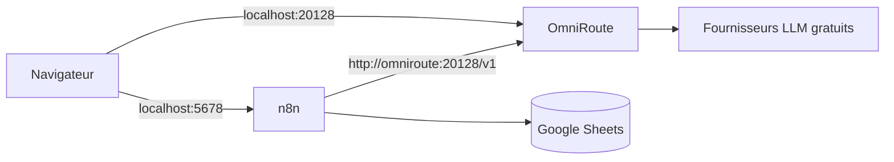

# AI Business Automation — n8n

Prototype de démonstration : automatisation du traitement des demandes clients et de l'extraction documentaire d'un centre d'appel au service d'artisans, avec n8n et des LLM gratuits.

Toutes les données sont fictives. Le cahier des charges complet est dans [`docs/cdc.md`](docs/cdc.md).

> Ce README couvre pour l'instant l'installation. Les sections Workflows, Prompts, Évaluation et Résultats seront complétées au fil du projet.

## Architecture



| Service | Rôle | Adresse locale |
|---|---|---|
| n8n | Orchestration des workflows | http://localhost:5678 |
| OmniRoute | Passerelle LLM compatible OpenAI, regroupe des fournisseurs gratuits | http://localhost:20128 |

Les deux ports ne sont publiés que sur `127.0.0.1`. n8n joint OmniRoute par le réseau Docker interne.

## Prérequis

- Docker et Docker Compose
- `openssl` (pour générer les secrets)
- Un compte Google (pour Google Sheets)

## Installation

### 1. Générer le fichier `.env`

```bash
./scripts/init_env.sh
```

Le script copie `.env.example` en `.env`, génère tous les secrets et affiche le mot de passe initial du dashboard OmniRoute. Il refuse d'écraser un `.env` existant.

Important : ne plus modifier `N8N_ENCRYPTION_KEY` après le premier lancement, sinon les credentials enregistrés dans n8n deviennent illisibles.

### 2. Lancer les services

```bash
docker compose up -d
docker compose ps
```

### 3. Configurer OmniRoute

1. Ouvrir http://localhost:20128 et se connecter avec le mot de passe affiché à l'étape 1.
2. Activer un ou plusieurs fournisseurs gratuits.
3. Créer une clé API et la reporter dans `.env` (`OMNIROUTE_API_KEY`).
4. Choisir le modèle de référence et le reporter dans `.env` (`LLM_MODEL`), puis `docker compose up -d` pour le prendre en compte.

### 4. Configurer n8n

1. Ouvrir http://localhost:5678 et créer le compte propriétaire.
2. Créer un credential **OpenAI** :
   - API Key : la clé OmniRoute ;
   - Base URL : `http://omniroute:20128/v1`.
3. Créer un credential **Header Auth** pour les webhooks :
   - Name : `X-Api-Key` ;
   - Value : la valeur de `WEBHOOK_API_KEY` dans `.env`.
4. Créer une clé dans **Settings > n8n API** et la reporter dans `.env` (`N8N_API_KEY`). Elle sert aux scripts lancés depuis le terminal.

## Versionner les workflows

Les workflows vivent dans la base de n8n. Pour les enregistrer dans le dépôt :

```bash
./scripts/export_workflows.sh   # n8n -> workflows/*.json, avec contrôle anti-secret
./scripts/import_workflows.sh   # workflows/*.json -> n8n
```

L'export ne contient pas la valeur des credentials, seulement leur nom. Après un import sur une nouvelle installation, il faut recréer les credentials (étape 4).

## Fichiers montés dans n8n

| Dossier du dépôt | Chemin dans le conteneur | Accès |
|---|---|---|
| `prompts/` | `/data/prompts` | lecture seule |
| `data/` | `/data/samples` | lecture seule |
| `workflows/` | `/data/workflows` | lecture et écriture |

## Arborescence

```text
.
├── docker-compose.yml
├── .env.example
├── workflows/        exports JSON des workflows n8n
├── prompts/          prompts versionnés, lus par les workflows
├── data/             données fictives : emails, CV, factures, FAQ
├── eval/             jeu d'évaluation, baseline, résultats
├── scripts/          initialisation, import et export
└── docs/             cahier des charges, fiches de panne, guide utilisateur
```

## Sécurité

- Aucun secret dans le dépôt : `.env` est ignoré par git, seul `.env.example` est versionné.
- Les credentials sont chiffrés par n8n avec `N8N_ENCRYPTION_KEY`.
- OmniRoute exige une clé API (`REQUIRE_API_KEY=true`), puisqu'il est joignable depuis un autre conteneur.
- Données fictives uniquement.
