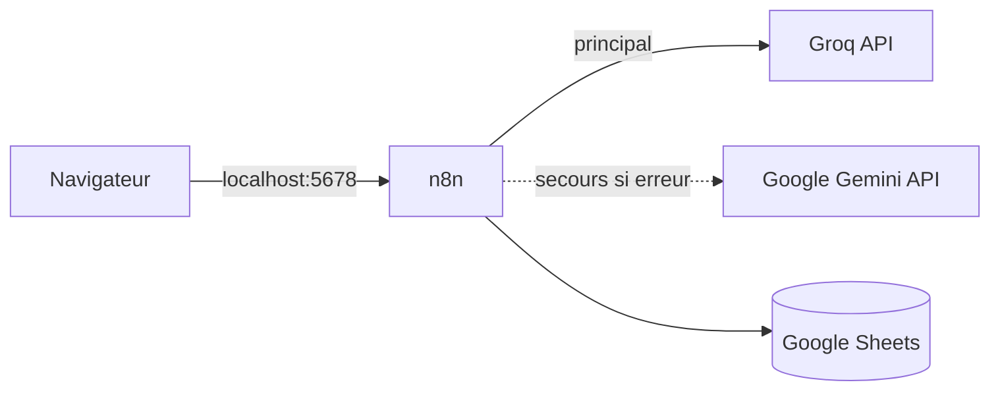

# AI Business Automation — n8n

Prototype de démonstration : automatisation du traitement des demandes clients et de l'extraction documentaire d'un centre d'appel au service d'artisans, avec n8n et des LLM gratuits (Groq, Google Gemini).

Toutes les données sont fictives. Le cahier des charges complet est dans [`docs/cdc.md`](docs/cdc.md).

> Ce README couvre pour l'instant l'installation. Les sections Workflows, Prompts, Évaluation et Résultats seront complétées au fil du projet.

## Architecture



| Composant | Rôle |
|---|---|
| n8n (Docker, local) | Orchestration des workflows, http://localhost:5678 |
| Groq | LLM principal, offre gratuite officielle |
| Google Gemini | LLM de secours, offre gratuite officielle, appelé si Groq échoue |
| Google Sheets | Stockage des résultats et de la FAQ |

Le port de n8n n'est publié que sur `127.0.0.1`. La bascule entre les deux fournisseurs est faite dans les workflows, par la sortie d'erreur du node LLM principal.

## Prérequis

- Docker et Docker Compose
- `openssl` (pour générer les secrets)
- Un compte Google (pour Google Sheets et la clé Gemini)
- Un compte Groq (gratuit)

## Installation

### 1. Générer le fichier `.env`

```bash
./scripts/init_env.sh
```

Le script copie `.env.example` en `.env` et génère les secrets. Il refuse d'écraser un `.env` existant.

Compléter ensuite à la main :

| Variable | Où l'obtenir |
|---|---|
| `GROQ_API_KEY` | https://console.groq.com, menu API Keys |
| `GEMINI_API_KEY` | https://aistudio.google.com, bouton Get API key |
| `LLM_PRIMARY_MODEL`, `LLM_FALLBACK_MODEL` | Voir la section Résultats (modèles retenus après le test comparatif) |

Important : ne plus modifier `N8N_ENCRYPTION_KEY` après le premier lancement, sinon les credentials enregistrés dans n8n deviennent illisibles.

### 2. Lancer n8n

```bash
docker compose up -d
docker compose ps
```

Le premier démarrage prend environ 30 secondes.

### 3. Configurer n8n

1. Ouvrir http://localhost:5678 et créer le compte propriétaire.
2. Créer les credentials des deux fournisseurs LLM, avec les clés du `.env` (le détail est donné dans la section Workflows).
3. Créer un credential **Header Auth** pour les webhooks :
   - Name : `X-Api-Key` ;
   - Value : la valeur de `WEBHOOK_API_KEY` dans `.env`.
4. Créer une clé dans **Settings > n8n API** et la reporter dans `.env` (`N8N_API_KEY`). Elle sert aux scripts lancés depuis le terminal.

### 4. Configurer Google Sheets

Le projet utilise un **compte de service** Google : une identité technique, sans expiration, qui n'a accès qu'au classeur qu'on lui partage.

1. Dans Google Cloud, créer un projet et activer **Google Sheets API** et **Google Drive API**.
2. Créer un compte de service (sans rôle), puis une clé **JSON**. Ne jamais placer ce fichier dans le dépôt.
3. Créer un classeur Google Sheets vide et le **partager** avec l'adresse du compte de service, en Éditeur.
4. Reporter dans `.env` l'identifiant du classeur (`GOOGLE_SHEET_ID`, dans l'URL entre `/d/` et `/edit`) et l'adresse du compte de service (`GOOGLE_SERVICE_ACCOUNT_EMAIL`), puis `docker compose up -d`.
5. Dans n8n, créer un credential **Google Service Account API** avec `client_email` et `private_key` de la clé JSON. Supprimer ensuite le fichier de clé.
6. Importer `workflows/wf0-setup-google-sheets.json`, lui associer le credential, et l'exécuter **une fois** : il crée les onglets décrits dans `config/sheets.json` et charge la FAQ.

## Versionner les workflows

Les workflows vivent dans la base de n8n. Pour les enregistrer dans le dépôt :

```bash
./scripts/export_workflows.sh   # n8n -> workflows/*.json, avec contrôle anti-secret
./scripts/import_workflows.sh   # workflows/*.json -> n8n
```

L'export ne contient pas la valeur des credentials, seulement leur nom. Après un import sur une nouvelle installation, il faut recréer les credentials (étape 3).

## Fichiers montés dans n8n

| Dossier du dépôt | Chemin dans le conteneur | Accès |
|---|---|---|
| `prompts/` | `/data/prompts` | lecture seule |
| `config/` | `/data/config` | lecture seule |
| `data/` | `/data/samples` | lecture seule |
| `workflows/` | `/data/workflows` | lecture et écriture |

## Arborescence

```text
.
├── docker-compose.yml
├── .env.example
├── config/         règles métier (source unique, lue par n8n et par les scripts)
├── workflows/        exports JSON des workflows n8n
├── prompts/          prompts versionnés, lus par les workflows
├── data/             données fictives : emails, CV, factures, FAQ
├── eval/             jeu d'évaluation, baseline, résultats
├── scripts/          initialisation, import, export, vérification des étiquettes
└── docs/             cahier des charges, fiches de panne, guide utilisateur
```

## Sécurité

- Aucun secret dans le dépôt : `.env` est ignoré par git, seul `.env.example` est versionné.
- Les credentials sont chiffrés par n8n avec `N8N_ENCRYPTION_KEY`.
- Les clés des fournisseurs LLM sont saisies dans des credentials n8n, jamais dans les workflows.
- Données fictives uniquement.
