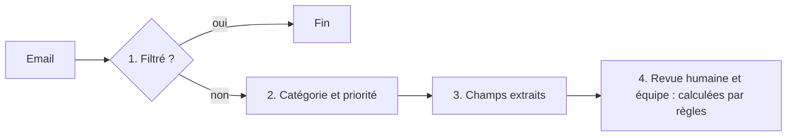

# Données de démonstration

Toutes les données de ce dossier sont **fictives**. Les noms, adresses, numéros de téléphone et entreprises sont inventés. Les adresses email utilisent des domaines `example.*`. Les numéros de téléphone sont pris dans des plages (`06 39 98`, `04 65 71`) couramment citées comme réservées aux œuvres de fiction, pour limiter le risque de tomber sur un vrai numéro.

## Contexte

Un centre d'appel gère, pour le compte d'artisans du bâtiment (plombiers, électriciens, chauffagistes...), les demandes de leurs clients : prise de rendez-vous, suivi d'intervention, questions, réclamations. Il reçoit aussi des messages d'artisans et des candidatures. Trois équipes traitent les demandes : les téléopérateurs, les chargés de suivi client et le recrutement.

## Fichiers

| Fichier | Contenu |
|---|---|
| `emails/email-NNN.json` | Un email entrant, au format attendu par le webhook du WF1 |
| `emails_labels.json` | Le résultat attendu pour chaque email (vérité terrain, saisie à la main) |
| `faq.csv` | Base de connaissances du centre d'appel |
| `cv/`, `invoices/` | Documents du WF2 |

## Format d'un email

```json
{
  "message_id": "msg-001",
  "received_at": "2026-10-05T09:12:00+02:00",
  "sender": "client@example.fr",
  "subject": "Objet de l'email",
  "body": "Corps du message, en texte ou en HTML",
  "attachments": [
    { "filename": "cv-lucas-martin.pdf", "path": "cv/cv-lucas-martin.pdf" }
  ]
}
```

- `received_at` est indispensable : c'est la date de référence pour résoudre « demain », « vendredi », etc.
- `attachments` est facultatif. Dans les fichiers de test, une pièce jointe désigne un fichier du dossier `data/` ; le script d'envoi le convertit en base64 au moment de l'envoi au webhook.

## Source de vérité des règles

Les valeurs de référence (catégories, priorités, table des équipes, conditions de revue, règles de filtrage) sont dans **`config/business_rules.json`**. Ce guide les explique en français ; en cas de différence, c'est le fichier de configuration qui fait foi, car c'est lui que le workflow applique.

Après toute modification des étiquettes ou des règles :

```bash
python3 scripts/check_labels.py
```

## Les quatre décisions à étiqueter



Les étapes 1 à 3 sont ce que le système doit **reconnaître**. L'étape 4 en **découle** par des règles fixes : elle est étiquetée pour vérifier la chaîne complète, mais n'est jamais demandée au LLM.

## 1. Filtrage (`expected_filtered`)

Un email est filtré, donc **non traité**, s'il s'agit :

- d'une réponse automatique : objet commençant par « Réponse automatique », « Absence du bureau », « Absent du bureau », « Out of office », « Automatic reply » ;
- d'une erreur de distribution : expéditeur `mailer-daemon` ou `postmaster`, objet commençant par « Undeliverable », « Delivery Status Notification » ou « Non remis ».

Les préfixes sont volontairement précis. Un préfixe trop court comme « Absence » filtrerait à tort un vrai message intitulé « Absence de chauffage chez ma mère » (email 009 du jeu de test).

Un expéditeur `no-reply` n'est **pas** filtré à lui seul : un formulaire de contact envoie de vraies demandes depuis une adresse `no-reply`. Une publicité n'est pas filtrée par règle : elle est classée `AUTRE`.

Pour un email filtré, `expected` vaut `null`.

## 2. Catégorie et priorité

### Catégorie (`category`)

| Valeur | Quand |
|---|---|
| `RENDEZ_VOUS` | Demande d'intervention, de visite ou de devis nécessitant un passage de l'artisan, ou demande de déplacement d'un rendez-vous |
| `SUIVI` | Question sur une intervention, un devis ou un dossier **déjà en cours** |
| `INFORMATION` | Question générale sans dossier en cours (horaires, zone couverte, tarifs, garanties), ou information transmise sans demande d'action (remerciement, avis) |
| `RECLAMATION` | Mécontentement : retard, travail mal fait, facture contestée, comportement |
| `CANDIDATURE` | Candidature spontanée ou réponse à une offre d'emploi du centre d'appel |
| `AUTRE` | Publicité, démarchage, message hors sujet, ou message dont l'intention ne peut pas être déterminée (avec `ambiguous: true`) |

Une demande de devis est classée `RENDEZ_VOUS` : pour des travaux, le devis s'établit après une **visite technique** de l'artisan, qu'il faut planifier.

### Plusieurs demandes dans un même message

On attribue **une seule catégorie : l'intention principale**. Les autres demandes sont conservées, en une phrase chacune, dans `secondary_requests`, pour que l'agent n'en oublie aucune.

L'intention principale est la première présente dans cet ordre (clé `primary_intent_order` de `config/business_rules.json`) :

| Rang | Catégorie | Pourquoi ce rang |
|---|---|---|
| 1 | `RECLAMATION` | Un mécontentement exprimé prime : il doit être traité par un humain |
| 2 | `RENDEZ_VOUS` | Une intervention à planifier, souvent avec une échéance |
| 3 | `SUIVI` | Un dossier en cours à faire avancer |
| 4 | `INFORMATION` | Une question sans action à engager |
| 5 | `CANDIDATURE` | Traitée par une autre équipe, sans urgence client |
| 6 | `AUTRE` | Par défaut |

Exemple : « Je n'ai pas la confirmation du rendez-vous de vendredi. Au fait, vous ouvrez le samedi ? » donne `SUIVI`, avec `secondary_requests` = `["Le service prend-il les appels le samedi matin ?"]`.

### Ne pas se laisser guider par le ton

La catégorie et la priorité dépendent de **ce que demande** la personne, pas de son émotion. Un client furieux qui demande un rendez-vous reste un `RENDEZ_VOUS` ; un client très poli qui conteste une facture est une `RECLAMATION`.

### Priorité (`priority`)

| Valeur | Quand |
|---|---|
| `URGENT` | Risque pour la sécurité ou dégât en cours : fuite active, odeur de gaz, panne électrique totale, absence de chauffage avec une personne vulnérable |
| `HIGH` | Échéance de moins de 48 heures après `received_at`, ou client qui relance (« je vous ai déjà écrit », « toujours sans nouvelles ») |
| `NORMAL` | Cas par défaut |
| `LOW` | Aucune réponse ni action attendue : remerciement, publicité |

Une question qui attend une réponse est au moins `NORMAL`.

La priorité ne dépend pas du ton du message : une réclamation polie peut être `NORMAL`, une demande de rendez-vous peut être `URGENT`.

Ces niveaux suivent la logique de la **matrice impact × urgence** utilisée par les services clients : l'impact mesure la gravité (sécurité, dégâts), l'urgence mesure la vitesse à laquelle la situation s'aggrave. `URGENT` correspond à un impact fort et une urgence forte ; `NORMAL` est le niveau par défaut d'une demande reçue par email.

## 3. Champs extraits

| Champ | Règle |
|---|---|
| `customer_name` | Nom de la personne qui écrit, tel qu'il apparaît (même si elle écrit pour un proche). `null` s'il n'est pas donné. |
| `company` | Entreprise de la personne qui écrit (par exemple un artisan qui écrit lui-même). `null` pour un particulier. L'artisan **concerné** par la demande n'est pas l'entreprise de l'expéditeur. |
| `email` | Adresse à laquelle on peut répondre : celle du corps du message si elle y figure, sinon l'expéditeur. `null` si l'expéditeur est une adresse automatique (`no-reply`, `ne-pas-repondre`) et qu'aucune adresse ne figure dans le corps. |
| `phone` | Numéro tel qu'écrit dans le message. `null` s'il n'est pas donné. |
| `requested_date` | Date d'une intervention **à venir**, souhaitée ou déjà prévue, au format `AAAA-MM-JJ`, **seulement si elle est déterminable**, y compris de façon relative (« demain », « vendredi », avec `received_at`). `null` pour une indication vague (« la semaine prochaine », « dès que possible ») et pour une date passée. |
| `summary` | Une phrase factuelle, sans information absente du message. Non évaluée automatiquement. |
| `secondary_requests` | Liste des demandes **autres que la demande principale**, une phrase par demande. Une demande est une question ou une action attendue distincte, même si elle relève de la même catégorie (« Avez-vous reçu mon devis ? Quand commencent les travaux ? » = une demande principale et une secondaire). Liste vide `[]` s'il n'y a qu'une demande. L'évaluation compare le **nombre** de demandes secondaires, pas leur formulation. |
| `ambiguous` | `true` seulement si **l'intention principale ne peut pas être déterminée** : message incompréhensible, contradictoire, ou trop vague pour savoir ce que veut la personne. La catégorie est alors `AUTRE`. Plusieurs demandes claires ne rendent **pas** un message ambigu. |

**Règle d'or : ne jamais inventer.** Une information absente du message vaut `null`, même si elle semble évidente.

## 4. Décisions calculées par règles

Ces deux valeurs ne sont pas demandées au LLM. Elles sont calculées par le WF1 à partir des étapes précédentes (CDC § 7.8 et § 7.9), avec les règles de `config/business_rules.json`. Le script `scripts/check_labels.py` vérifie que chaque étiquette les respecte.

### Revue humaine (`expected_manual_review`)

`true` si au moins une condition est vraie :

- `category` vaut `RECLAMATION` ou `AUTRE` ;
- `priority` vaut `URGENT` ;
- `ambiguous` vaut `true` ;
- ni `email` ni `phone` ne sont renseignés.

### Équipe (`expected_team`)

| Catégorie | Équipe |
|---|---|
| `RENDEZ_VOUS`, `INFORMATION`, `AUTRE` | `TELEOPERATEURS` |
| `SUIVI`, `RECLAMATION` | `SUIVI_CLIENT` |
| `CANDIDATURE` | `RECRUTEMENT` |

Pour un email filtré, `expected_manual_review` vaut `false` et `expected_team` vaut `null`.

## Format d'une étiquette

```json
{
  "message_id": "msg-001",
  "expected_filtered": false,
  "expected": {
    "category": "RENDEZ_VOUS",
    "priority": "NORMAL",
    "customer_name": "Marie Lefèvre",
    "company": null,
    "email": "marie.lefevre@example.fr",
    "phone": "06 39 98 12 34",
    "requested_date": null,
    "secondary_requests": [],
    "ambiguous": false
  },
  "expected_manual_review": false,
  "expected_team": "TELEOPERATEURS",
  "difficulty": "facile",
  "trap": "Description du piège testé, ou null"
}
```

## La FAQ (`faq.csv`)

| Colonne | Contenu |
|---|---|
| `id` | Identifiant (`faq-01`...) |
| `category` | Catégorie de demande à laquelle l'entrée répond |
| `question`, `answer` | La question type et la réponse validée |
| `source` | `fictif` pour la politique du centre d'appel (inventée pour le scénario), ou la référence d'une **information réelle** (sécurité gaz, dégât des eaux, garanties légales, entretien des chaudières, RGE) |

Les entrées fictives décrivent un centre d'appel imaginaire : horaires, délais, frais. Les entrées réelles sont sourcées et ne doivent pas être modifiées sans vérifier la source.

**Source de vérité : l'onglet `faq` du classeur, pas ce fichier.** `faq.csv` n'est que la valeur initiale, chargée une fois par le WF0. Ensuite, l'équipe modifie la FAQ dans le classeur, et c'est là que le WF1 la lit. L'évaluation de bout en bout (`eval/run_eval.py`) passe par le WF1, donc par la même FAQ que la production.

**Règle d'injection dans le brouillon :** les entrées de la catégorie principale de l'email, plus toujours les entrées `INFORMATION` (questions générales). Sans cette règle, une question secondaire comme « ouvrez-vous le samedi ? » dans un email de suivi (email 005) n'aurait aucune réponse disponible.

## Sources des règles

| Règle | Source |
|---|---|
| Une seule intention par demande, avec un ordre de priorité explicite entre intentions | Guide *Ticket routing* d'Anthropic : « A request may have ONLY ONE applicable intent » et « Clarify the prioritization of intents so that Claude can better rank the extracted intents and identify the primary concern ». https://platform.claude.com/docs/en/about-claude/use-case-guides/ticket-routing |
| Ignorer l'émotion pour classer | Même guide : le modèle peut « prioritize addressing the emotion over solving the underlying problem » ; solution proposée : « Ignore all customer emotions. Focus only on analyzing the intent ». |
| Priorité = impact × urgence ; le délai de réponse (SLA) découle de la priorité | Définition de la matrice de priorité : https://www.getmacha.com/glossary/priority-matrix |
| Devis = visite technique à planifier | Pratique courante des plateformes de mise en relation avec des artisans (visite technique puis devis). https://www.habitatpresto.com/mag/salle-de-bain-wc/artisan-salle-de-bain-autour-de-moi |
