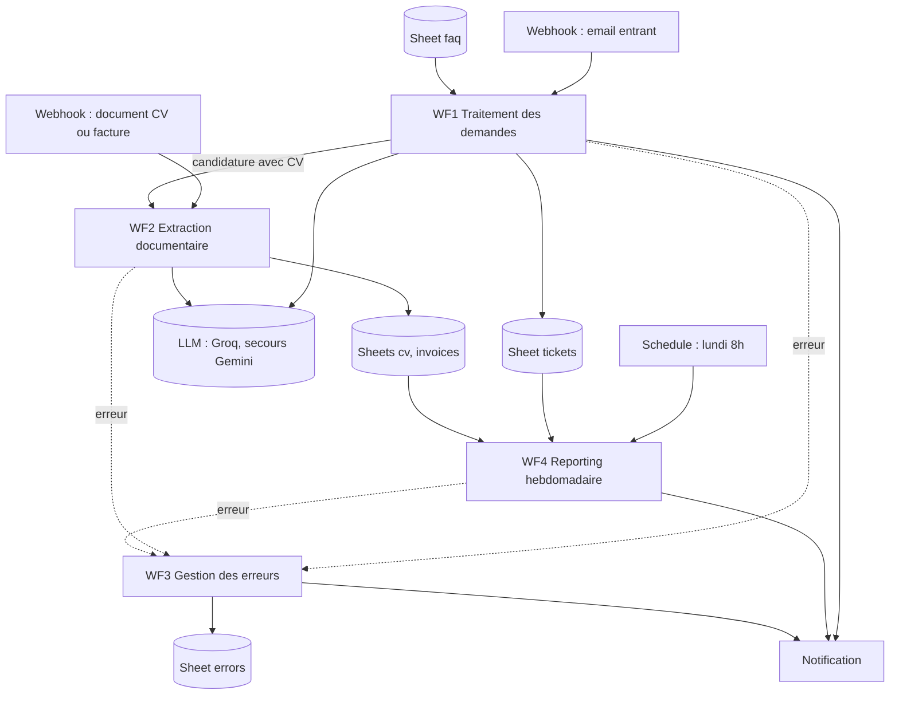
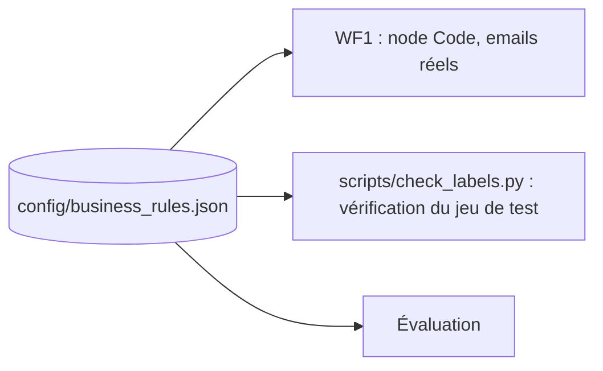
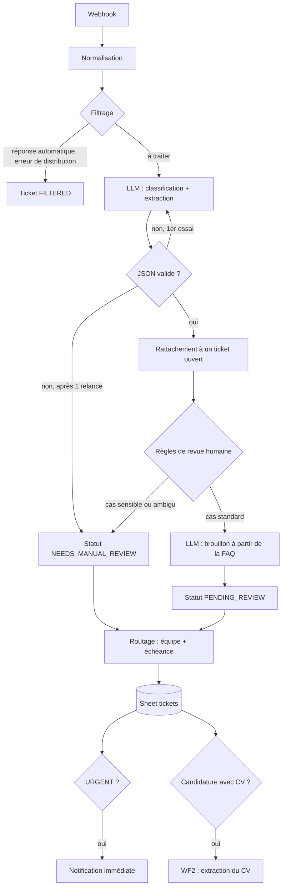
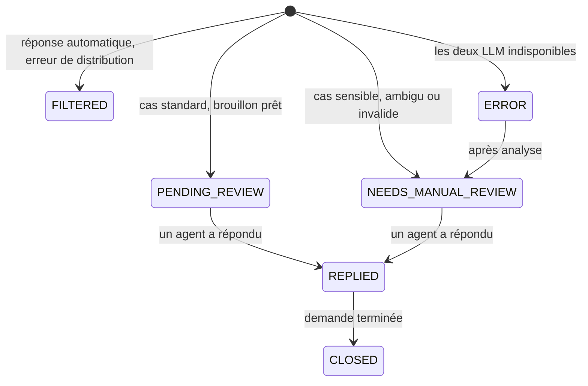
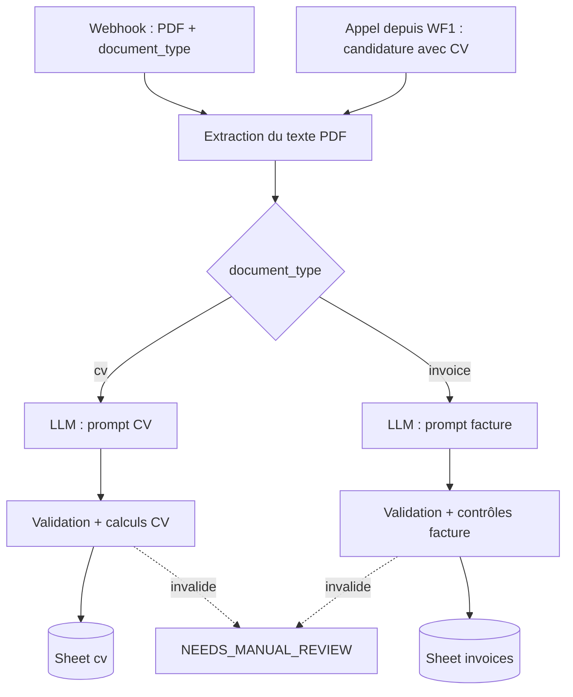
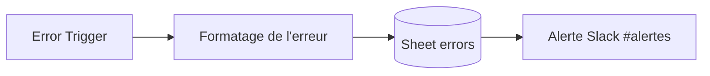
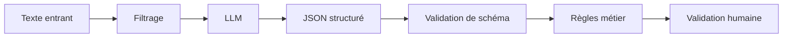
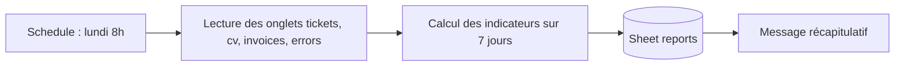

# Cahier des charges — `ai-business-automation-n8n`

| | |
|---|---|
| **Projet** | AI Business Automation — n8n |
| **Dépôt** | `ai-business-automation-n8n` |
| **Type** | Prototype de démonstration (MVP) |
| **Auteur** | Toandromananjara Mahasalotra |
| **Version** | 3.5 — 2026-10-08 |

Historique des versions :

| Version | Changement |
|---|---|
| 2.0 | Réécriture du cahier des charges initial, alignement sur l'offre |
| 2.1 | Retrait de la passerelle OmniRoute, appels directs à Groq et Gemini |
| 3.0 | Alignement sur le fonctionnement réel d'un centre d'appel : filtrage, rattachement, routage par équipe, délais de réponse, catégorie `CANDIDATURE`, registre `tickets` |
| 3.1 | Règles d'étiquetage sourcées : une intention principale par demande, demandes secondaires conservées, ambiguïté redéfinie, seuils de réussite fixés avant la mesure |
| 3.2 | Modèles choisis après test comparatif ; calendrier dans le message envoyé au modèle ; filet de sécurité des 48 heures dans le code |
| 3.3 | Prompt de brouillon : sortie avec citations de FAQ et points non couverts, contrôles automatiques ; passage en JSON simple (troncature silencieuse du mode strict) |
| 3.4 | WF3 (gestion des erreurs) ; statut `ERROR` quand les deux LLM sont indisponibles ; alertes Slack |
| 3.5 | WF2 réalisé : PDF et DOCX, détection des scans, contrôles des factures ; FAQ du classeur comme source de vérité ; évaluation de bout en bout |

---

## 1. Présentation

### 1.1 Objectif

Démontrer, sur un scénario réaliste, comment **n8n + un LLM + des API + des données structurées** automatisent le traitement des demandes entrantes d'un centre d'appel, **de façon fiable** : sorties structurées, validées, mesurées, avec une validation humaine quand c'est nécessaire.

Le système doit :

- recevoir les demandes entrantes ;
- écarter ce qui ne doit pas être traité (réponses automatiques, erreurs de distribution) ;
- rattacher une demande au dossier déjà ouvert du même client ;
- classifier chaque demande et en extraire les informations utiles ;
- l'**aiguiller vers la bonne équipe** avec une échéance de réponse ;
- proposer une réponse, ancrée sur une base de connaissances, sans l'envoyer ;
- extraire les données de documents (CV, factures) ;
- détecter, journaliser et signaler les erreurs ;
- produire un reporting hebdomadaire ;
- mesurer sa propre fiabilité sur un jeu de test.

### 1.2 Contexte métier

Le scénario est celui d'un **centre d'appel qui gère, pour le compte d'artisans du bâtiment en France** (plombiers, électriciens, chauffagistes), les demandes de leurs clients : prise de rendez-vous, suivi d'intervention, questions, réclamations. Il reçoit aussi des messages d'artisans et des candidatures.

Important : il s'agit d'un **prototype indépendant**, construit avec des **données entièrement fictives**. Ce n'est ni un système développé pour une entreprise donnée, ni un outil en production.

### 1.3 Fil conducteur

Le projet doit raconter cette histoire, plus importante que le nombre de nodes :

> J'ai identifié une tâche répétitive, conçu un workflow, intégré un LLM, structuré et validé ses sorties, aiguillé chaque demande vers la bonne équipe, prévu les pannes, conservé une validation humaine là où elle est nécessaire, puis **mesuré** la fiabilité et le gain.

---

## 2. Correspondance avec l'offre ciblée

| Exigence de l'offre | Livrable du projet |
|---|---|
| Tri des emails | WF1 : filtrage, classification, routage par équipe, échéance de réponse |
| Libérer téléopérateurs, chargés de suivi client, recrutement | Routage vers ces trois équipes (§ 6.8) |
| Extraction des données de CV et de factures | WF2, déclenché aussi par les candidatures reçues dans WF1 |
| Reporting hebdomadaire | WF4 |
| Connecter les outils via API et webhooks | Entrée par webhook, Google Sheets, API LLM, notification |
| Rédiger et faire évoluer les prompts | Dossier `prompts/` versionné |
| Construire des bases de connaissances | FAQ utilisée pour les brouillons de réponse (§ 9) |
| Contrôler la fiabilité, limiter les hallucinations | Validation, règles métier, évaluation chiffrée (§ 11, § 12) |
| Documenter : rôle, fonctionnement, procédure en cas de panne | README + fiche de panne par workflow (§ 15) |
| Créer des guides simples pour des non-spécialistes | Guide utilisateur par équipe (§ 15) |
| Mesurer le temps gagné | Méthode de mesure explicite (§ 13) |
| Pragmatisme, solution proportionnée | Choix justifiés (§ 19), ex. pas de base vectorielle pour 30 entrées |
| Plus : pratique d'un CRM | Registre `tickets` conçu comme substitut d'un CRM (§ 5) ; intégration CRM en V2 |

---

## 3. Périmètre

| Fonctionnalité | Version |
|---|---|
| Orchestration n8n | MVP |
| Entrée par webhook | MVP |
| Filtrage avant traitement | MVP |
| Classification et extraction par LLM, avec bascule Groq vers Gemini | MVP |
| Validation JSON et règles métier | MVP |
| Rattachement à un ticket ouvert | MVP |
| Routage par équipe et échéance de réponse | MVP |
| Brouillon de réponse ancré sur la FAQ | MVP |
| Registre `tickets` dans Google Sheets | MVP |
| Notification des demandes urgentes | MVP |
| Gestion des erreurs et journal | MVP |
| Extraction CV (y compris depuis une candidature reçue) | MVP |
| Extraction factures | MVP |
| Reporting hebdomadaire planifié | MVP |
| Jeu d'évaluation et baseline | MVP |
| Fiches de panne et guide utilisateur | MVP |
| Entrée Gmail réelle | V2 |
| Accusé de réception automatique | V2 |
| CRM (HubSpot, Pipedrive ou Kommo) | V2 |
| Transcription d'appel vers note de suivi | V2 |
| Échéances calculées en heures ouvrées | V2 |
| Proposition de créneaux (Calendar) | V2 |
| RAG avec base vectorielle | V2 |
| Interface de validation dédiée | V2 |

**Hors périmètre :** backend API devant n8n, dashboard React, infrastructure de production (reverse proxy, HTTPS, sauvegardes). Ces éléments n'apportent rien au poste visé et relèvent de compétences déjà démontrées ailleurs.

---

## 4. Architecture



### 4.1 Stockage Google Sheets

Un classeur unique, un onglet par usage :

| Onglet | Contenu | Équivalent en production |
|---|---|---|
| `tickets` | Une ligne par demande : champs extraits, équipe, échéance, statut, brouillon | Tickets de l'outil de ticketing ou du CRM |
| `cv` | Candidats extraits par WF2 | Fiches candidats de l'outil de recrutement |
| `invoices` | Factures extraites par WF2 | Saisie comptable |
| `faq` | Base de connaissances (question, réponse, catégorie) | Base de connaissances interne |
| `errors` | Journal d'erreurs alimenté par WF3 | Outil de supervision |
| `reports` | Historique des rapports hebdomadaires | Tableaux de bord du CRM |

### 4.2 Principe de conception

**Le LLM extrait, le code calcule et décide.** Le LLM lit du texte et produit du JSON. Tout le reste est fait par du code déterministe dans des nodes n8n : filtrage, calcul des dates relatives, validation, règles de revue humaine, routage, échéances, rattachement, contrôles de factures, durée d'expérience des CV.

Conséquence : une décision du système peut toujours être expliquée par une règle écrite, jamais par « le modèle a jugé que ».

### 4.3 Une seule source de vérité pour les règles métier

Toutes les règles métier sont dans **`config/business_rules.json`** : catégories et priorités autorisées, ordre des intentions, table de routage, délais de réponse, relèvement de priorité à l'approche d'une échéance, conditions de revue humaine, règles de filtrage, fenêtre de rattachement.



Ce fichier est lu à la fois par le WF1 (monté en lecture seule dans le conteneur, sous `/data/config`) et par les scripts de vérification et d'évaluation. Une règle n'est jamais écrite deux fois : la modifier à un endroit la modifie partout, et les tests vérifient toujours la règle que le workflow applique réellement.

---

## 5. Positionnement : prototype et réalité

Ce prototype reproduit la **logique** du traitement des emails d'un centre d'appel, pas ses outils. Le tableau suivant indique, pour chaque élément, ce qu'on trouve dans un vrai centre et ce qui le remplace ici.

| Élément | Dans un vrai centre d'appel | Dans le prototype | Pourquoi ce choix |
|---|---|---|---|
| Réception des emails | Boîte partagée connectée à un outil de ticketing ou au CRM | Webhook | C'est le mécanisme réel d'intégration, dit *push-based* : l'outil de ticketing (par exemple Zendesk) envoie un événement webhook au service de routage à chaque nouveau ticket (guide *Ticket routing* d'Anthropic). Le webhook rend aussi les tests rejouables. |
| File de travail des agents | Ticketing (Zendesk, Freshdesk...) ou CRM (HubSpot, Kommo...) | Onglet `tickets` | Montre la logique sans dépendre d'un outil payant. Remplacer le dernier node suffit pour écrire dans un vrai CRM. |
| Tri | Remplir les champs du ticket et l'aiguiller vers une file | Catégorie, priorité, équipe, échéance | Identique en logique |
| Délai de réponse (SLA) | Calculé en heures ouvrées | Calculé en heures calendaires | Simplification assumée, V2 |
| Accusé de réception | Envoyé automatiquement, à partir d'un modèle fixe | Non envoyé (pas de canal sortant dans le MVP) | V2, avec l'entrée Gmail |
| Réponse à un client | Rédigée ou validée par l'agent | Brouillon proposé, jamais envoyé seul | Identique |
| Statistiques | Produites par l'outil | WF4 sur le Sheet | Identique en logique |

**Pourquoi pas de tri dans une boîte Gmail :** dans un vrai centre, la boîte mail n'est qu'un point d'entrée. Le tri se fait dans l'outil où les équipes travaillent. Brancher une boîte Gmail montrerait une connexion technique, pas une compréhension du métier. L'entrée Gmail est donc le premier élément de la V2, pour la démonstration, pas un élément du tri.

---

## 6. Données de démonstration

Toutes les données sont **fictives** et versionnées dans `data/`. Les règles d'annotation sont dans `data/README.md`.

| Jeu | Volume | Usage |
|---|---|---|
| Emails | 30 | Démonstration WF1 et évaluation |
| Étiquettes attendues | 30 | Vérité terrain pour l'évaluation, saisie à la main |
| CV | 5 | WF2, dont 1 reçu en pièce jointe d'une candidature |
| Factures | 5 | WF2, dont 1 avec une erreur de total |
| FAQ | 25 entrées, dont 6 informations réelles sourcées | Base de connaissances |

Répartition visée des 30 emails : environ 18 cas standards traités sans revue obligatoire, et 12 cas difficiles ou sensibles. Toutes les catégories et toutes les priorités sont représentées, ainsi que 2 ou 3 emails à filtrer (réponse automatique, erreur de distribution).

Cas pièges à inclure : date vague ou relative, expéditeur automatique sans coordonnées, deux demandes dans un même message (une principale, une secondaire), message réellement ambigu, client en colère qui demande simplement un rendez-vous, odeur de gaz, réclamation polie, artisan cité qui n'est pas l'expéditeur, date passée, message en partie en anglais, publicité, client qui relance.

---

## 7. Workflow 1 — Traitement des demandes

### 7.1 Flux



### 7.2 Entrée

Requête `POST` sur le webhook, protégée par l'en-tête `X-Api-Key` :

```json
{
  "message_id": "msg-001",
  "received_at": "2026-10-05T09:12:00+02:00",
  "sender": "marie.lefevre@example.fr",
  "subject": "Fuite sous l'évier",
  "body": "Bonjour, ...",
  "attachments": [
    { "filename": "cv.pdf", "mime_type": "application/pdf", "content_base64": "..." }
  ]
}
```

`attachments` est facultatif. Le format est indépendant de la source : un CRM, un outil de ticketing, une boîte Gmail (V2) ou un formulaire peuvent tous produire ce même objet.

### 7.3 Normalisation (node Code)

- suppression du HTML ;
- suppression des signatures automatiques et des citations de messages précédents ;
- normalisation des espaces et des caractères parasites ;
- conservation de `received_at`, indispensable pour résoudre les dates relatives.

### 7.4 Filtrage (node Code, avant tout appel au LLM)

Un email est écarté, avec le statut `FILTERED` et la raison dans `review_reason`, s'il s'agit (listes dans `config/business_rules.json`, clé `filtering`) :

- d'une **réponse automatique** : objet commençant par « Réponse automatique », « Absence du bureau », « Absent du bureau », « Out of office », « Automatic reply » ;
- d'une **erreur de distribution** : expéditeur `mailer-daemon` ou `postmaster`, objet commençant par « Undeliverable », « Delivery Status Notification » ou « Non remis ».

Les préfixes sont précis à dessein : « Absence » seul filtrerait à tort « Absence de chauffage chez ma mère », un cas urgent présent dans le jeu de test. Le script `check_labels.py` applique la règle de filtrage à chaque email de test et la compare aux étiquettes.

Pourquoi avant le LLM : ces messages ne demandent aucune action, et chaque appel évité économise le quota du fournisseur. Un expéditeur `no-reply` n'est **pas** filtré à lui seul : un formulaire de contact du site envoie de vraies demandes depuis une adresse `no-reply`.

Les publicités ne sont pas filtrées par règle (trop variables) : le LLM les classe en `AUTRE`.

### 7.5 Classification et extraction (un seul appel LLM)

Un seul appel produit classification et extraction : moins de latence, moins de tokens, une seule sortie à valider.

L'appel part vers le modèle principal (Groq, `qwen/qwen3.8-27b`). S'il échoue malgré les relances, la sortie d'erreur du node envoie la même requête au modèle de secours (Google, `gemini-3.1-flash-lite`). Le nom du modèle qui a répondu est conservé dans la colonne `model`. Le choix des modèles est documenté dans `eval/model-selection.md`.

Le message envoyé au modèle contient, en plus de l'email normalisé, la date de réception avec son jour et un **calendrier des 14 jours suivants** (« mardi 13 octobre = 2026-10-13 »). Le modèle lit la date correspondant à « mardi prochain » au lieu de la calculer : lors du test comparatif, les erreurs de calcul de dates étaient la principale source d'erreurs.

Les requêtes HTTP vers les fournisseurs envoient un en-tête `User-Agent` explicite : Cloudflare, devant l'API de Groq, refuse les requêtes qui n'en ont pas (erreur 403, « error code: 1010 »).

```json
{
  "category": "RENDEZ_VOUS",
  "priority": "URGENT",
  "customer_name": "Thomas Garnier",
  "company": null,
  "email": "t.garnier@example.com",
  "phone": "07 81 22 45 90",
  "requested_date": "2026-10-07",
  "secondary_requests": [],
  "summary": "Dégât des eaux en cours après la rupture d'un flexible de douche, intervention demandée le lendemain matin.",
  "ambiguous": false
}
```

**Une seule catégorie par demande.** Quand un message contient plusieurs demandes, la catégorie est l'**intention principale**, choisie selon un ordre fixe (`primary_intent_order` dans `config/business_rules.json`) : `RECLAMATION`, puis `RENDEZ_VOUS`, `SUIVI`, `INFORMATION`, `CANDIDATURE`, `AUTRE`. Les autres demandes sont conservées dans `secondary_requests`, une phrase chacune, pour que l'agent n'en oublie aucune.

`ambiguous` vaut `true` seulement si l'intention principale ne peut pas être déterminée (message incompréhensible, contradictoire ou trop vague). Plusieurs demandes claires ne rendent pas un message ambigu.

La classification porte sur ce que demande la personne, pas sur son émotion.

**Valeurs autorisées** (définitions détaillées dans `data/README.md`) :

| Champ | Valeurs |
|---|---|
| `category` | `RENDEZ_VOUS`, `SUIVI`, `INFORMATION`, `RECLAMATION`, `CANDIDATURE`, `AUTRE` |
| `priority` | `URGENT`, `HIGH`, `NORMAL`, `LOW` |

Catégorie et priorité sont deux axes distincts : une réclamation peut être urgente ou non.

### 7.6 Validation (node Code)

- le JSON se parse ;
- `category` et `priority` appartiennent aux listes autorisées ;
- `summary` est présent et non vide ;
- `email`, s'il est présent, a un format valide ;
- `requested_date`, si elle est présente, est une date ISO qui n'est pas antérieure à `received_at`.

En cas d'échec : **une seule relance** du LLM avec le message d'erreur, puis `NEEDS_MANUAL_REVIEW`.

### 7.7 Rattachement

Si l'email ou le téléphone extrait correspond à un ticket **ouvert** (statut autre que `CLOSED` et `FILTERED`) créé dans les 30 derniers jours, l'identifiant de ce ticket est inscrit dans `related_ticket_id`.

Dans le MVP, une nouvelle ligne est tout de même créée, avec le lien vers le ticket existant : l'agent voit immédiatement que le client a déjà une demande en cours. Un outil de ticketing fusionnerait les deux ; c'est une simplification assumée.

Une relance d'un client sur un ticket ouvert fait passer la priorité au moins à `HIGH` (règle d'annotation : « client qui relance »).

### 7.8 Règles de revue humaine

Une demande passe en `NEEDS_MANUAL_REVIEW` si au moins une condition est vraie (`config/business_rules.json`, clé `manual_review`) :

| Condition | Raison inscrite dans `review_reason` |
|---|---|
| `category` vaut `RECLAMATION` | Réclamation : réponse à rédiger par un humain |
| `category` vaut `AUTRE` | Demande non reconnue |
| `priority` vaut `URGENT` | Urgence : traitement immédiat par un humain |
| `ambiguous` vaut `true` | Intention principale impossible à déterminer |
| ni `email` ni `phone` | Aucun moyen de recontacter le client |
| JSON invalide après relance | Sortie du modèle inexploitable |

Les autres demandes reçoivent un brouillon et le statut `PENDING_REVIEW` : un agent relit avant tout envoi.

Les règles sont volontairement simples et lisibles par un non-développeur. Elles sont reprises dans le guide utilisateur.

### 7.9 Routage et échéance (node Code)

Le routage est **déterminé par le code**, à partir de la catégorie, et non demandé au LLM (`config/business_rules.json`, clé `team_by_category`) :

| Catégorie | Équipe (`team`) |
|---|---|
| `RENDEZ_VOUS` | `TELEOPERATEURS` |
| `INFORMATION` | `TELEOPERATEURS` |
| `AUTRE` | `TELEOPERATEURS` |
| `SUIVI` | `SUIVI_CLIENT` |
| `RECLAMATION` | `SUIVI_CLIENT` |
| `CANDIDATURE` | `RECRUTEMENT` |

Les trois équipes sont celles que cite l'offre : téléopérateurs, chargés de suivi client, recrutement.

**Filet de sécurité sur la priorité.** Avant le routage, le code relève la priorité au moins à `HIGH` si `requested_date` tombe moins de 48 heures après `received_at`, quelle que soit la réponse du modèle (clé `deadline_escalation` de `config/business_rules.json`). Le modèle garde la règle des 48 heures pour les cas que le code ne peut pas voir : une relance, ou une échéance qui ne concerne pas une intervention.

L'échéance de réponse (`due_at`) découle de la priorité (clé `response_delay_hours`) :

| Priorité | Délai de réponse |
|---|---|
| `URGENT` | 1 heure |
| `HIGH` | 4 heures |
| `NORMAL` | 24 heures |
| `LOW` | 72 heures |

Dans le MVP, les délais sont comptés en heures calendaires. Le calcul en heures ouvrées (nuits, week-ends) est en V2. Ces valeurs sont des hypothèses de démonstration : dans une entreprise, elles sont fixées par le contrat de service avec les artisans.

### 7.10 Brouillon de réponse

Un second appel LLM rédige un brouillon **uniquement à partir des entrées de la FAQ** injectées : celles de la catégorie principale, plus toujours les entrées `INFORMATION` (questions générales). Le brouillon répond aussi aux demandes de `secondary_requests` quand ces entrées le permettent. Si la FAQ ne couvre pas la question, le brouillon le dit et propose un rappel par un conseiller, au lieu d'inventer une réponse.

**Aucune réponse rédigée par le LLM n'est envoyée automatiquement.** L'accusé de réception à modèle fixe (V2) est la seule communication automatique envisagée : il ne contient aucun texte généré.

Le modèle ne renvoie pas seulement un texte, mais :

```json
{
  "draft": "Bonjour Madame Lefèvre, ...",
  "faq_ids_used": ["faq-08", "faq-11"],
  "unanswered": []
}
```

- `faq_ids_used` : les entrées de FAQ sur lesquelles le brouillon s'appuie. Le code vérifie qu'elles font partie des entrées fournies : une citation inventée signale un brouillon inventé.
- `unanswered` : les points de l'email que la FAQ ne couvre pas. L'agent voit immédiatement ce qu'il doit compléter.

Deux contrôles déterministes sont appliqués à chaque brouillon :

| Contrôle | Règle |
|---|---|
| Citations | Chaque identifiant cité fait partie des entrées fournies |
| Nombres | Chaque nombre du brouillon (délai, prix, numéro, horaire) figure dans l'email, la qualification ou les entrées de FAQ citées |
| Signature | Le brouillon se termine par la signature (« Le service client » ou « Customer Service ») ; sinon il est probablement tronqué |

Un brouillon qui échoue à un contrôle n'est pas proposé tel quel : la demande passe en `NEEDS_MANUAL_REVIEW` avec la raison du rejet.

Règles du prompt (`prompts/draft_response.md`) : n'utiliser que les entrées qui répondent à une demande du client ; ne prendre aucun engagement (rendez-vous, date, montant), mais pouvoir accuser réception ; répondre dans la langue du client.

L'agent indique ce qu'il a fait du brouillon dans `draft_outcome` : `SENT_AS_IS` (envoyé tel quel), `EDITED` (corrigé puis envoyé), `DISCARDED` (écarté). C'est la mesure de l'utilité réelle des brouillons.

### 7.11 Notification

Une alerte est envoyée dans le canal Slack `#alertes` pour les demandes `URGENT` et pour les tickets `ERROR` (demande non qualifiée faute de LLM). Les autres demandes attendent dans la file de leur équipe : notifier chaque email noierait les agents et ferait ignorer les alertes importantes.

L'alerte contient l'identifiant du ticket, l'équipe, le client et son téléphone, le résumé et l'échéance de réponse. Une panne de Slack n'empêche pas de répondre à l'appelant : le ticket est déjà écrit.

**Les deux LLM indisponibles.** Si Groq puis Gemini échouent, le ticket est quand même créé, avec le statut `ERROR`, l'expéditeur et l'objet de l'email, et la raison de la panne. La demande n'est jamais perdue : elle reste dans la file, traitée à la main.

### 7.12 Statuts



Dans le MVP, les agents font évoluer le statut en modifiant la colonne `status` du Sheet.

### 7.13 Colonnes de l'onglet `tickets`

| Groupe | Colonnes |
|---|---|
| Identification | `ticket_id`, `message_id`, `received_at`, `processed_at`, `related_ticket_id` |
| Données extraites | `customer_name`, `company`, `email`, `phone`, `category`, `priority`, `requested_date`, `secondary_requests`, `summary` |
| Aiguillage | `team`, `due_at`, `status`, `review_reason` |
| Réponse | `draft_response`, `draft_faq_ids`, `draft_unanswered`, `draft_outcome` |
| Traçabilité | `model`, `execution_id` |

---

## 8. Workflow 2 — Extraction documentaire

### 8.1 Flux



WF2 est un sous-workflow : il peut être appelé directement par webhook, ou par WF1 lorsqu'une candidature contient un CV en pièce jointe. La ligne du Sheet `cv` garde alors le `ticket_id` d'origine.

Formats traités :

| Format | Traitement |
|---|---|
| PDF contenant du texte | Extraction du texte (node Extract From File) |
| DOCX | Un `.docx` est une archive zip : décompression (node Compression), puis lecture du texte de `word/document.xml`. Le node de décompression ne reconnaissant une archive qu'à son extension, le fichier lui est présenté comme `.zip`. |
| PDF scanné (image) | Texte vide ou presque (moins de 50 caractères) : revue humaine, **sans appel au LLM** |
| Autre format | Revue humaine, « format non pris en charge » |

La lecture des scans par un modèle multimodal (Gemini accepte images et PDF) est en V2 : cas rares, et un CV contient des données personnelles.

Le prompt de facture impose de **recopier sans corriger** : si le modèle corrigeait un total faux, le contrôle du code ne pourrait plus le détecter.

Résultat sur le jeu de test (5 CV, 5 factures, `data/documents_labels.json`) : **10 documents sur 10 conformes**, dont la facture au total faux et celle à l'échéance incohérente, détectées.

### 8.2 CV

Sortie attendue du LLM :

```json
{
  "name": "Lucas Martin",
  "email": "lucas.martin@example.com",
  "phone": "06 00 00 00 00",
  "skills": ["Accueil téléphonique", "Excel", "Prise de rendez-vous"],
  "experiences": [
    { "title": "Téléconseiller", "company": "Exemple SARL", "start": "2022-01", "end": "2024-06" }
  ],
  "education": "BTS Négociation et digitalisation de la relation client"
}
```

- `experience_years` est **calculé par le code** à partir de `experiences`, pas demandé au LLM.
- Validation : `name` présent, `email` au format valide, `skills` est une liste de chaînes, dates d'expérience cohérentes (début avant fin).

### 8.3 Factures

Sortie attendue du LLM :

```json
{
  "supplier": "Fournitures Exemple SAS",
  "invoice_number": "F-2026-0142",
  "invoice_date": "2026-09-30",
  "due_date": "2026-10-30",
  "amount_excl_tax": 1000.00,
  "tax_amount": 200.00,
  "amount_incl_tax": 1200.00,
  "currency": "EUR"
}
```

Contrôles déterministes :

- `amount_excl_tax + tax_amount = amount_incl_tax`, à 0,01 près ;
- `due_date` postérieure ou égale à `invoice_date` ;
- `currency` est un code ISO 4217.

Un contrôle qui échoue envoie la facture en `NEEDS_MANUAL_REVIEW`. La facture de démonstration au total erroné doit être détectée : c'est la preuve qu'une sortie plausible du LLM n'est pas acceptée sans vérification.

---

## 9. Workflow 3 — Gestion des erreurs

Workflow distinct déclenché par le node **Error Trigger** de n8n, configuré comme *error workflow* des workflows 1, 2 et 4.



Le WF3 traite les pannes **imprévues** : requête mal formée, bug dans un node, Google Sheets inaccessible. La panne **prévue** des deux LLM est traitée dans le WF1 lui-même (statut `ERROR`, § 7.11).

Il classe chaque panne par type (`QUOTA_LLM`, `LLM_INDISPONIBLE`, `GOOGLE_SHEETS`, `REQUETE_INVALIDE`, `AUTRE`), l'écrit dans l'onglet `errors`, puis l'annonce dans Slack. Si Google Sheets est lui-même en panne, l'écriture du journal échoue sans bloquer l'alerte Slack.

Dans cette version de n8n, un workflow d'erreur doit être **publié** (activé) pour pouvoir être désigné par un autre workflow.

Les appels aux API externes utilisent **Retry On Fail** (3 essais, délai croissant) avant de déclencher la bascule ou WF3.

Colonnes de l'onglet `errors` : `timestamp`, `workflow`, `execution_id`, `node`, `error_type`, `error_message`, `input_ref`, `status`.

Principe : une panne ne fait jamais perdre une demande. Elle est journalisée, notifiée, et la demande passe en revue manuelle.

---

## 10. Base de connaissances

La base de connaissances est une **FAQ de 20 à 30 entrées** dans l'onglet `faq` : horaires du service, délais d'intervention, zone couverte, modalités d'annulation, suivi d'un dossier, devis, garanties, recrutement.

Seules les entrées de la catégorie principale et les entrées générales (`INFORMATION`) sont injectées dans le prompt du brouillon : le contexte reste court, ce qui économise le quota de tokens, tout en couvrant les questions secondaires les plus courantes (horaires, zone, frais).

La FAQ distingue la **politique du centre**, fictive, et les **informations réelles** (urgence gaz, dégât des eaux, garanties légales, entretien des chaudières, RGE), chacune avec sa source.

**Choix assumé :** pas de base vectorielle dans le MVP. Avec quelques dizaines d'entrées, tout le contenu tient dans le contexte du modèle. Un RAG avec embeddings ajouterait de l'infrastructure sans gain mesurable. Il deviendra pertinent quand la base dépassera ce que le contexte peut contenir, ou avec des documents longs non structurés (V2).

Avantage pour l'adoption : un non-développeur enrichit la FAQ en modifiant simplement le Sheet.

**Une seule source de vérité : l'onglet `faq` du classeur.** `data/faq.csv` sert uniquement de valeur initiale, chargée par le WF0. L'évaluation finale passe par le WF1, donc par la FAQ du classeur : ce qui est mesuré est ce qui tourne en production.

---

## 11. Prompts

Les prompts sont stockés dans `prompts/`, versionnés, et non écrits en dur dans les nodes.

| Fichier | Usage |
|---|---|
| `classify_extract.md` | WF1 : classification et extraction |
| `draft_response.md` | WF1 : brouillon à partir de la FAQ |
| `extract_cv.md` | WF2 : CV |
| `extract_invoice.md` | WF2 : facture |

Chaque prompt définit :

- le rôle et le contexte ;
- les valeurs autorisées et leurs définitions (reprises de `data/README.md`) ;
- le schéma JSON exact attendu, sans texte autour ;
- la consigne de **retourner `null` pour toute information absente** et l'interdiction d'inventer ;
- la consigne de positionner `ambiguous: true` en cas de doute ;
- deux ou trois exemples, dont un avec des champs manquants. **Aucun exemple ne vient du jeu de test** : le modèle ne doit pas voir les réponses attendues de l'évaluation.

Les listes de valeurs du prompt (catégories, priorités, ordre des intentions) ne sont pas écrites en dur : elles sont injectées depuis `config/business_rules.json` au moment de l'appel.

Les appels utilisent le mode **JSON simple** (`response_format` de type `json_object`), et non le mode strict `json_schema` : en mode strict, Groq tronque silencieusement les textes de `qwen3.8-27b` vers 140 tokens, tout en renvoyant un JSON valide (`eval/model-selection.md`). La conformité au schéma est vérifiée par le code (§ 7.6).

---

## 12. Garde-fous contre les hallucinations

Le projet ne se limite pas à `Email → LLM → réponse` :



| Garde-fou | Mécanisme |
|---|---|
| Pas d'invention | `null` imposé pour les données absentes, vérifié par l'évaluation |
| Valeurs bornées | Listes fermées vérifiées dans le code |
| Sortie exploitable | Validation de schéma, une seule relance |
| Calculs et décisions fiables | Faits par le code : dates, routage, échéances, totaux |
| Réponses ancrées | Brouillon limité au contenu de la FAQ |
| Cas sensibles | Revue humaine obligatoire |
| Rien n'est envoyé seul | Tout texte généré reste un brouillon |

---

## 13. Évaluation

### 13.1 Pourquoi

Affirmer que « les hallucinations sont limitées » ne vaut rien sans mesure. L'évaluation transforme cette affirmation en chiffres.

### 13.2 Méthode

1. Étiqueter à la main les 30 emails selon `data/README.md`.
2. **Baseline non-LLM** : un classifieur par mots-clés (ex. « rendez-vous », « passer » → `RENDEZ_VOUS`). Si le LLM ne bat pas nettement cette règle triviale, c'est le prompt ou le jeu de données qu'il faut revoir.
3. Faire passer les 30 emails dans WF1, **avec le modèle principal seul** (sans bascule), et comparer aux étiquettes.
4. Publier les résultats dans le README, **quels qu'ils soient**, avec les erreurs commentées.

### 13.3 Métriques

| Métrique | Définition |
|---|---|
| Exactitude du filtrage | Part des emails correctement filtrés ou conservés |
| Précision de classification | Part des emails dont `category` est correcte (LLM et baseline) |
| Exactitude de la priorité | Part des emails dont `priority` est correcte |
| Exactitude par champ | Part des champs extraits égaux à l'attendu |
| Demandes secondaires | Part des emails dont le **nombre** de `secondary_requests` est correct |
| Taux de JSON valide | Part des sorties valides au premier essai |
| Taux d'invention | Part des champs attendus `null` que le LLM a remplis |
| Exactitude du routage vers un humain | Part des emails dont la décision de revue humaine est correcte |

Le routage par équipe découle de la catégorie par une table fixe : il n'est pas évalué séparément.

### 13.4 Seuils de réussite, fixés avant la mesure

Les seuils sont définis **avant** de lancer l'évaluation, pour ne pas les ajuster après coup aux résultats obtenus. Ils s'inspirent des repères du guide *Ticket routing* d'Anthropic (exactitude de routage de 90 à 95 %, au moins 80 % sur les cas limites), adaptés à un jeu de 30 emails.

| Métrique | Seuil visé | Commentaire |
|---|---|---|
| Précision de classification, cas standards | au moins 90 % | |
| Précision de classification, cas difficiles | au moins 80 % | |
| LLM contre baseline | écart nettement positif | Sinon, le prompt ou les données sont à revoir |
| Taux de JSON valide au premier essai | au moins 95 % | La relance couvre le reste |
| Taux d'invention | 0 visé, chaque cas analysé | Une invention est plus grave qu'une erreur de catégorie |
| Exactitude de la revue humaine | 100 % des cas sensibles envoyés en revue | Un faux négatif (cas sensible non revu) est l'erreur la plus coûteuse |

Avec 30 emails, une seule erreur fait varier un taux de plus de 3 points : ces seuils indiquent une tendance, pas une garantie.

Outil : `eval/run_eval.py` envoie les 30 emails au **vrai WF1** (webhook de production), marqués d'un identifiant de série de test, compare chaque ticket à son étiquette et écrit `eval/results.md`. Les séries de test ne sont jamais rattachées aux vrais tickets et ne déclenchent pas d'alerte Slack.

### 13.5 Évaluation des brouillons

Les brouillons sont évalués **séparément** de la classification, sur les 17 emails qui en reçoivent un. Le modèle reçoit la qualification attendue (l'étiquette) : on mesure la qualité du brouillon seule, sans que les erreurs de classification la faussent.

1. Contrôles automatiques : JSON valide, citations valides, aucun nombre non sourcé, signature présente.
2. **Relecture humaine** de chaque brouillon, avec une grille : fidèle (rien d'inventé), complet (chaque demande traitée ou signalée), ton (professionnel, sans engagement), langue.

Les contrôles automatiques sont nécessaires mais pas suffisants : lors de la première exécution, ils étaient tous au vert alors que la relecture a trouvé 5 brouillons tronqués et une réponse en français à un client anglophone (`eval/draft-review.md`).

Attention : 30 exemples donnent un ordre de grandeur, pas une estimation précise. Le README le dit.

---

## 14. Mesure du temps gagné

Le temps gagné repose sur des **hypothèses explicites**, présentées comme telles :

- `T_manuel` : temps de traitement manuel d'un email (lecture, qualification, saisie, rédaction de la réponse). **À mesurer** en traitant soi-même 10 emails du jeu de test au chronomètre.
- `T_revue` : temps de relecture et validation d'un brouillon. **À mesurer** de la même façon.

```text
Gain estimé = N_traités × (T_manuel − T_revue)
```

Le rapport affiche ce gain avec la mention « estimation fondée sur T_manuel = X min et T_revue = Y min, mesurés sur 10 emails ». Aucun chiffre n'est écrit avant d'avoir été mesuré.

---

## 15. Workflow 4 — Reporting hebdomadaire

Déclenché par un **Schedule Trigger** chaque lundi à 8h, et déclenchable manuellement pour la démonstration.



Indicateurs :

- nombre de demandes reçues, dont filtrées ;
- répartition par catégorie, par priorité et **par équipe** ;
- part avec brouillon (`PENDING_REVIEW`) contre part en revue obligatoire (`NEEDS_MANUAL_REVIEW`) ;
- **demandes en retard** : échéance dépassée sans réponse ;
- utilité des brouillons : répartition de `draft_outcome` (envoyés tels quels, corrigés, écartés) ;
- erreurs techniques par type ;
- documents traités et rejetés par les contrôles ;
- temps gagné estimé (§ 14).

---

## 16. Documentation livrable

### 16.1 README

1. Présentation et fil conducteur
2. Architecture
3. Prototype et réalité (reprise du § 5)
4. Installation et configuration
5. Description de chaque workflow
6. Prompts
7. Gestion des erreurs
8. Résultats de l'évaluation
9. Exemples avant / après
10. Captures d'écran n8n
11. Choix techniques et justification
12. Limites
13. Roadmap

### 16.2 Fiches de panne (`docs/runbooks/`)

Une fiche par workflow, au même format :

- **Rôle** : ce que fait le workflow, en une phrase ;
- **Fonctionnement** : déclencheur, étapes, sorties ;
- **Symptômes de panne** : ce qu'on observe ;
- **Diagnostic** : où regarder (onglet `errors`, exécutions n8n) ;
- **Procédure** : quoi faire, et comment rejouer une exécution.

### 16.3 Guide utilisateur (`docs/guide-utilisateur.md`)

Une page par équipe, sans jargon technique :

- trouver les demandes de son équipe et les trier par échéance ;
- comprendre les statuts et la colonne `review_reason` ;
- relire, corriger ou écarter un brouillon, puis renseigner `draft_outcome` ;
- repérer une demande liée à un ticket déjà ouvert (`related_ticket_id`) ;
- signaler une erreur de l'outil.

---

## 17. Sécurité

- Aucune clé API dans le dépôt : variables dans `.env` (ignoré par git, comme toutes ses variantes), modèle dans `.env.example`.
- Clés des fournisseurs saisies dans les credentials n8n, chiffrés ; jamais dans les workflows ni dans leurs exports.
- Script d'export des workflows avec contrôle anti-secret.
- Données fictives uniquement, aucune donnée personnelle réelle.
- Webhooks protégés par un en-tête d'authentification (Header Auth n8n).
- Port de n8n publié uniquement sur `127.0.0.1`.

---

## 18. Arborescence du dépôt

```text
ai-business-automation-n8n/
├── README.md
├── docker-compose.yml
├── .env.example
├── .gitignore
├── config/
│   └── business_rules.json
├── workflows/
│   ├── wf1-request-processing.json
│   ├── wf2-document-extraction.json
│   ├── wf3-error-handler.json
│   └── wf4-weekly-report.json
├── prompts/
│   ├── classify_extract.md
│   ├── draft_response.md
│   ├── extract_cv.md
│   └── extract_invoice.md
├── data/
│   ├── README.md
│   ├── emails/
│   ├── emails_labels.json
│   ├── cv/
│   ├── invoices/
│   └── faq.csv
├── eval/
│   ├── llm.py
│   ├── compare_models.py
│   ├── model-selection.md
│   ├── check_drafts.py
│   ├── draft-review.md
│   ├── baseline_keywords.py
│   ├── run_eval.py
│   └── results.md
├── scripts/
│   ├── init_env.sh
│   ├── check_labels.py
│   ├── export_workflows.sh
│   ├── import_workflows.sh
│   └── send_email.py
└── docs/
    ├── cdc.md
    ├── guide-utilisateur.md
    ├── screenshots/
    └── runbooks/
        ├── wf1.md
        ├── wf2.md
        ├── wf3.md
        └── wf4.md
```

---

## 19. Décisions

### 19.1 Décisions prises

| Décision | Choix | Justification |
|---|---|---|
| Hébergement n8n | **Docker en local** (édition Community) | Gratuit, sans limite d'exécutions ni d'expiration ; reproductible avec `docker compose up` |
| LLM principal | **Groq**, offre gratuite officielle, appel direct | Réponses en 0,4 à 2 s lors des tests ; sortie JSON structurée |
| LLM de secours | **Google Gemini**, offre gratuite officielle, appel direct | Fournisseur indépendant de Groq |
| Modèle principal | **Groq `qwen/qwen3.8-27b`** | Aucune erreur sur le test comparatif, le plus rapide (0,8 s), aucun token de raisonnement (`eval/model-selection.md`) |
| Modèle de secours | **Google `gemini-3.1-flash-lite`** | Aussi précis, plus lent ; autre fournisseur que le principal |
| Bascule entre fournisseurs | **Dans n8n**, par la sortie d'erreur du node principal | Visible et testable |
| Canal d'alerte | **Slack** (espace gratuit, bot avec le seul droit `chat:write`) | Courant en entreprise, sans OAuth ni expiration. Google Chat écarté : ses webhooks sont réservés aux comptes Google Workspace payants. En production : le canal de l'équipe (Slack, Teams, Google Chat), seul le dernier node change. |
| Entrée des emails | **Webhook** ; Gmail en V2 | Mécanisme réel d'intégration avec un CRM ou un ticketing ; tests rejouables |
| Lieu du tri | **Registre `tickets`**, substitut d'un CRM ; pas de libellés Gmail | Un centre d'appel trie dans son outil de travail, pas dans la boîte mail |
| Routage | **Table fixe catégorie → équipe**, dans le code | Décision explicable et testable, sans dépendre du LLM |
| Règles métier | **Fichier unique `config/business_rules.json`**, lu par le workflow et par les tests | Pas de règle dupliquée, donc pas de divergence entre ce qui est appliqué et ce qui est vérifié |

### 19.2 Décision révisée : abandon de la passerelle OmniRoute

La version 2.0 prévoyait une passerelle auto-hébergée (OmniRoute) devant les fournisseurs gratuits. Elle a été testée le 2026-10-07, puis retirée.

| Constat mesuré | Conséquence |
|---|---|
| Catalogue de modèles périmé : des modèles proposés n'existaient plus chez le fournisseur | Erreurs à l'exécution sur des modèles pourtant listés |
| Erreurs 403 sur Groq via la passerelle, alors que les mêmes appels en direct répondaient en moins de 2 s | Cause impossible à diagnostiquer : la passerelle masquait le message d'origine |
| Gemini saturé (503) : relances internes, 60 à 80 s par réponse | La bascule promise ne compensait pas, faute d'un second fournisseur fonctionnel |

Une dépendance qu'on ne peut pas déboguer va contre l'objectif d'automatisations simples et robustes. La bascule entre fournisseurs est conservée, mais implémentée dans n8n.

### 19.3 Contraintes induites par les LLM gratuits

- **Quota mesuré (Groq, 2026-10-07)** : 1 000 requêtes par jour et **8 000 tokens par minute**. Un appel de classification consomme environ 2 450 tokens, soit environ 3 appels par minute. Le plafond réel est celui des tokens : prompts compacts, FAQ filtrée par catégorie, raisonnement des modèles `gpt-oss` réglé au minimum, filtrage avant le LLM.
- **Modèle figé pour l'évaluation** : modèle principal seul ; le secours est évalué séparément.
- **Modèle tracé** : colonne `model` dans `tickets`, `cv` et `invoices`.
- **Sortie structurée inégale** : la validation côté n8n reste la garantie principale.
- **Confidentialité** : acceptable ici car les données sont fictives. Avec des données réelles, fournisseur sous contrat ou modèle hébergé en interne, validé avec le responsable sécurité.
- **Catalogue mouvant** : noms des modèles dans `.env` (`LLM_PRIMARY_MODEL`, `LLM_FALLBACK_MODEL`).

### 19.4 Décisions ouvertes

| Décision | Options | Impact |
|---|---|---|
| Date limite de candidature | À fixer | Découpage du planning (§ 22) |

---

## 20. Critères d'acceptation du MVP

- [ ] Les 30 emails de test sont traités par WF1 sans intervention, avec un statut et une équipe pour chacun.
- [ ] Les réponses automatiques et erreurs de distribution sont filtrées sans appel au LLM.
- [ ] Toute réclamation, toute demande urgente, ambiguë ou sans coordonnées passe en `NEEDS_MANUAL_REVIEW`.
- [ ] Chaque ticket a une échéance de réponse cohérente avec sa priorité.
- [ ] Une relance d'un client est rattachée à son ticket ouvert.
- [ ] Une demande urgente déclenche une notification immédiate.
- [ ] Aucun texte généré n'est envoyé automatiquement.
- [ ] Une candidature avec CV produit une ligne dans `cv`, liée au ticket.
- [ ] Les 5 factures sont extraites ; la facture au total erroné est détectée.
- [ ] Une panne simulée (clé API invalide) déclenche la bascule, puis, si les deux échouent, une ligne dans `errors` et une notification.
- [ ] Le rapport hebdomadaire se génère sur déclenchement manuel, avec les demandes en retard.
- [ ] Les résultats d'évaluation (LLM et baseline) figurent dans le README.
- [ ] Une fiche de panne existe pour chaque workflow, ainsi que le guide utilisateur.
- [ ] Le dépôt ne contient aucun secret.
- [ ] Un tiers peut lancer le projet en suivant uniquement le README.

---

## 21. Roadmap V2

| Évolution | Apport |
|---|---|
| Entrée Gmail réelle | Démonstration de bout en bout : un email arrive, le workflow démarre. Même format d'entrée que le webhook. |
| Accusé de réception automatique | Modèle fixe envoyé à la réception, sans texte généré |
| CRM (HubSpot gratuit en priorité) | Le registre `tickets` est remplacé par de vrais tickets et contacts |
| Transcription d'appel vers note de suivi | Cœur du métier d'un centre d'appel. Groq propose un modèle de transcription (`whisper-large-v3`). |
| Échéances en heures ouvrées | Délais de réponse réalistes (nuits, week-ends, jours fériés) |
| Fusion des tickets liés | Un seul ticket par demande au lieu d'une ligne liée |
| Proposition de créneaux | Lecture des disponibilités dans un agenda, proposition soumise à validation |
| RAG avec base vectorielle | Quand la base de connaissances dépasse ce que le contexte peut contenir |
| OCR des documents scannés | Factures et CV non textuels |
| Interface de validation | File de revue avec boutons, à la place de l'édition du Sheet |

---

## 22. Planning indicatif

| Étape | Contenu | Durée estimée |
|---|---|---|
| 1 | Données fictives, FAQ, choix des modèles, prompts | 0,5 jour |
| 2 | Classeur Google Sheets et credentials | 0,25 jour |
| 3 | WF1 complet (filtrage, LLM, validation, règles, routage, rattachement, brouillon) et WF3 | 1,25 jour |
| 4 | Évaluation, baseline, mesure de `T_manuel` et `T_revue` | 0,5 jour |
| 5 | WF2 (CV et factures, lien avec WF1), WF4 | 0,5 jour |
| 6 | README, fiches de panne, guide utilisateur, captures d'écran | 0,5 jour |

Total : environ **3,5 jours**. Si la date limite l'impose, l'ordre de priorité est : WF1 + WF3, puis évaluation, puis WF2, puis WF4.
