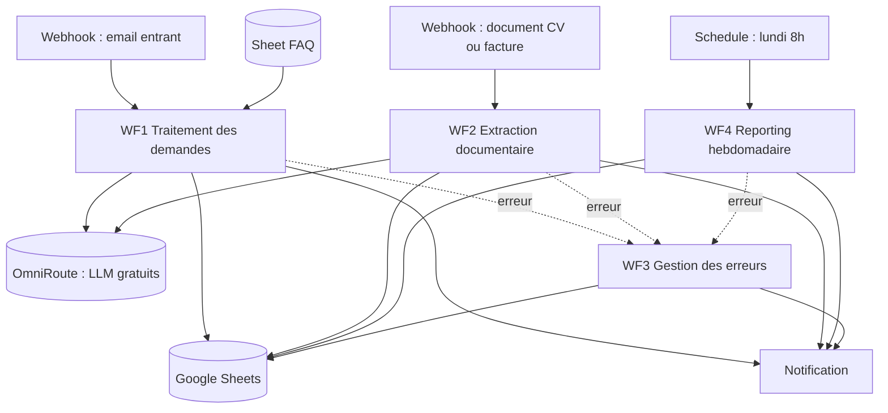
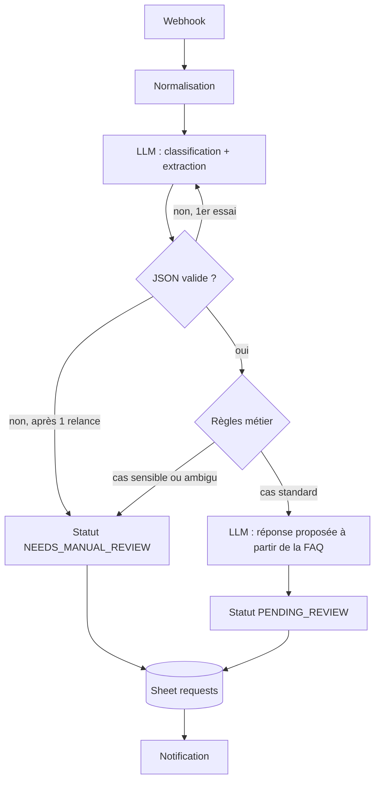
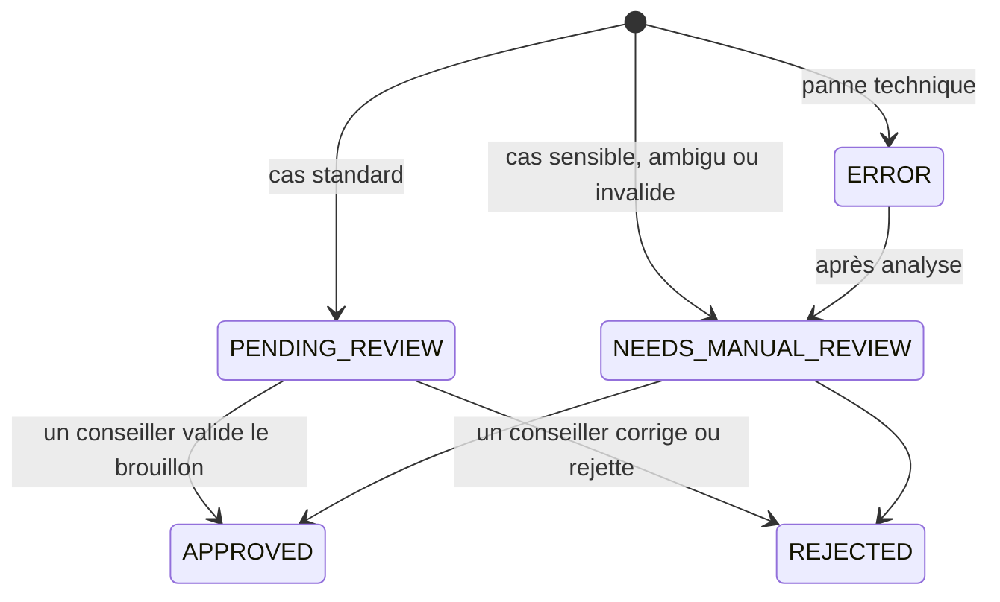
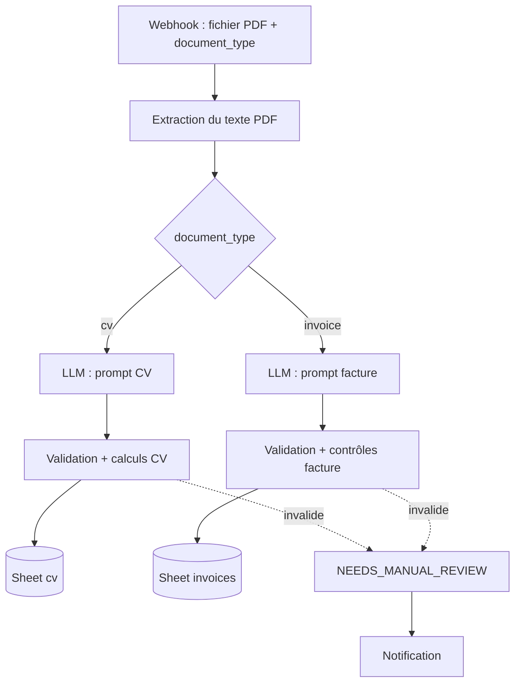
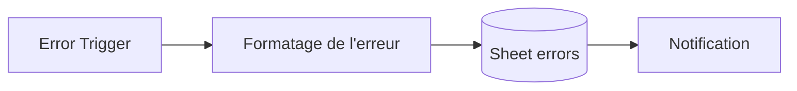
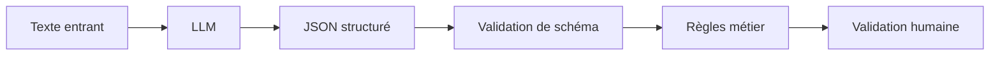
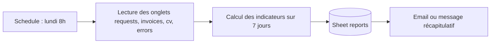

# Cahier des charges — `ai-business-automation-n8n`

| | |
|---|---|
| **Projet** | AI Business Automation — n8n |
| **Dépôt** | `ai-business-automation-n8n` |
| **Type** | Prototype de démonstration (MVP) |
| **Auteur** | Toandromananjara Mahasalotra |
| **Version** | 2.0 — 2026-10-07 |

---

## 1. Présentation

### 1.1 Objectif

Démontrer, sur un scénario réaliste, comment **n8n + un LLM + des API + des données structurées** automatisent des tâches répétitives d'un service client, **de façon fiable** : sorties structurées, validées, mesurées, avec une validation humaine quand c'est nécessaire.

Le système doit :

- recevoir des demandes entrantes ;
- les classifier et en extraire les informations utiles ;
- proposer une réponse, ancrée sur une base de connaissances, sans l'envoyer ;
- extraire les données de documents (CV, factures) ;
- stocker les résultats dans un format exploitable ;
- détecter, journaliser et signaler les erreurs ;
- produire un reporting hebdomadaire ;
- mesurer sa propre fiabilité sur un jeu de test.

### 1.2 Contexte métier

Le scénario de démonstration est celui d'un **centre d'appel au service d'artisans en France** (plombiers, électriciens, chauffagistes) : les clients des artisans écrivent pour prendre rendez-vous, demander un suivi, poser une question ou réclamer.

Important : il s'agit d'un **prototype indépendant**, construit avec des **données entièrement fictives**. Ce n'est ni un système développé pour une entreprise donnée, ni un outil en production.

### 1.3 Fil conducteur

Le projet doit raconter cette histoire, plus importante que le nombre de nodes :

> J'ai identifié une tâche répétitive, conçu un workflow, intégré un LLM, structuré et validé ses sorties, connecté les outils, prévu les pannes, conservé une validation humaine là où elle est nécessaire, puis **mesuré** la fiabilité et le gain.

---

## 2. Correspondance avec l'offre ciblée

| Exigence de l'offre | Livrable du projet |
|---|---|
| Tri des emails | Workflow 1 — Traitement des demandes |
| Extraction des données de CV et de factures | Workflow 2 — Extraction documentaire |
| Reporting hebdomadaire | Workflow 4 — Reporting |
| Connecter les outils via API et webhooks | Webhook, Google Sheets, API LLM, notification |
| Rédiger et faire évoluer les prompts | Dossier `prompts/` versionné |
| Construire des bases de connaissances | FAQ artisans utilisée pour les réponses (§ 9) |
| Contrôler la fiabilité, limiter les hallucinations | Validation, règles métier, évaluation chiffrée (§ 11, § 12) |
| Documenter : rôle, fonctionnement, procédure en cas de panne | README + fiche de panne par workflow (§ 15) |
| Créer des guides simples pour des non-spécialistes | Guide utilisateur téléopérateur (§ 15) |
| Mesurer le temps gagné | Méthode de mesure explicite (§ 13) |
| Pragmatisme, solution proportionnée | Choix justifiés dans le README (ex. pas de base vectorielle pour 30 entrées) |

---

## 3. Périmètre

| Fonctionnalité | Version |
|---|---|
| Orchestration n8n | MVP |
| Entrée par webhook | MVP |
| Classification et extraction par LLM | MVP |
| Validation JSON et règles métier | MVP |
| Réponse proposée, ancrée sur la FAQ | MVP |
| Stockage Google Sheets | MVP |
| Notification | MVP |
| Gestion des erreurs et journal | MVP |
| Extraction CV | MVP |
| Extraction factures | MVP |
| Reporting hebdomadaire planifié | MVP |
| Jeu d'évaluation et baseline | MVP |
| Fiches de panne et guide utilisateur | MVP |
| Gmail réel | V2 |
| CRM (HubSpot, Pipedrive ou Kommo) | V2 |
| Transcription d'appel vers note de suivi | V2 |
| Proposition de créneaux (Calendar) | V2 |
| RAG avec base vectorielle | V2 |
| Interface de validation dédiée | V2 |

**Hors périmètre :** backend API devant n8n, dashboard React, infrastructure de production (reverse proxy, HTTPS, sauvegardes). Ces éléments n'apportent rien au poste visé et relèvent de compétences déjà démontrées ailleurs.

---

## 4. Architecture



### 4.1 Stockage Google Sheets

Un classeur unique, un onglet par usage :

| Onglet | Contenu |
|---|---|
| `requests` | Demandes traitées par WF1 |
| `cv` | Candidats extraits par WF2 |
| `invoices` | Factures extraites par WF2 |
| `faq` | Base de connaissances (question, réponse, catégorie) |
| `errors` | Journal d'erreurs alimenté par WF3 |
| `reports` | Historique des rapports hebdomadaires |

### 4.2 Principe de conception

**Le LLM extrait, le code calcule et décide.** Le LLM ne fait que lire du texte et produire du JSON. Tout calcul (durée d'expérience, totaux de facture, dates relatives) et toute décision de routage sont faits dans des nodes Code déterministes.

---

## 5. Données de démonstration

Toutes les données sont **fictives** et versionnées dans `data/`.

| Jeu | Volume | Usage |
|---|---|---|
| Emails clients | 30 | Démonstration WF1 et évaluation |
| Étiquettes attendues des emails | 30 | Vérité terrain pour l'évaluation (saisie à la main) |
| CV | 5 | Démonstration WF2 |
| Factures | 5 | Démonstration WF2, dont 1 avec une erreur de total |
| FAQ artisans | 15 à 30 entrées | Base de connaissances |

Le jeu d'emails doit inclure des cas difficiles : demande sans email ni téléphone, deux demandes dans un même message, date relative (« demain matin »), réclamation formulée poliment, message hors sujet, message en partie en anglais.

---

## 6. Workflow 1 — Traitement des demandes

### 6.1 Flux



### 6.2 Entrée

Requête `POST` sur le webhook :

```json
{
  "message_id": "msg-001",
  "received_at": "2026-10-07T09:12:00+02:00",
  "sender": "jean.dupont@example.com",
  "subject": "Demande de rendez-vous",
  "body": "<p>Bonjour, je suis Jean Dupont ...</p>"
}
```

Le Webhook est préféré au Gmail Trigger pour le MVP : il évite la configuration OAuth et rend la démonstration rejouable à l'identique.

### 6.3 Normalisation (node Code)

- suppression du HTML ;
- suppression des signatures et des citations de messages précédents ;
- normalisation des espaces et des caractères parasites ;
- conservation de `received_at`, indispensable pour résoudre les dates relatives.

### 6.4 Classification et extraction (un seul appel LLM)

Un seul appel produit classification et extraction : moins de latence, moins de coût, et une seule sortie à valider.

```json
{
  "category": "RENDEZ_VOUS",
  "priority": "HIGH",
  "customer_name": "Jean Dupont",
  "company": "Dupont Plomberie",
  "email": "jean.dupont@example.com",
  "phone": null,
  "requested_date": "2026-10-08",
  "summary": "Demande de rappel demain matin pour fixer un rendez-vous concernant un dossier en cours.",
  "ambiguous": false
}
```

**Valeurs autorisées :**

| Champ | Valeurs |
|---|---|
| `category` | `RENDEZ_VOUS`, `INFORMATION`, `RECLAMATION`, `SUIVI`, `AUTRE` |
| `priority` | `LOW`, `NORMAL`, `HIGH`, `URGENT` |

Note : la version précédente du CDC mettait `URGENT` parmi les catégories. C'est une priorité, pas un type de demande : une réclamation peut être urgente ou non. Les deux axes sont donc séparés.

### 6.5 Validation (node Code)

- le JSON se parse ;
- `category` et `priority` appartiennent aux listes autorisées ;
- `summary` est présent et non vide ;
- `email`, s'il est présent, a un format valide ;
- `requested_date`, si elle est présente, est une date ISO qui n'est pas dans le passé par rapport à `received_at`.

En cas d'échec : **une seule relance** du LLM avec le message d'erreur, puis bascule en `NEEDS_MANUAL_REVIEW`.

### 6.6 Règles métier

Une demande passe en `NEEDS_MANUAL_REVIEW` si au moins une condition est vraie :

- `category` vaut `RECLAMATION` ou `AUTRE` ;
- `priority` vaut `URGENT` ;
- `ambiguous` vaut `true` ;
- ni `email` ni `phone` ne sont renseignés (impossible de recontacter le client).

Les règles sont volontairement simples et lisibles par un non-développeur. Elles sont décrites dans le guide utilisateur.

### 6.7 Réponse proposée

Un second appel LLM rédige un brouillon de réponse **uniquement à partir des entrées de la FAQ** de la même catégorie. Si la FAQ ne couvre pas la question, le brouillon le dit et propose un rappel par un conseiller, au lieu d'inventer une réponse.

**Aucune réponse n'est envoyée automatiquement.**

### 6.8 Statuts



Dans le MVP, la validation humaine se fait en modifiant la colonne `status` dans le Sheet.

### 6.9 Colonnes de l'onglet `requests`

`message_id`, `received_at`, `processed_at`, `customer_name`, `company`, `email`, `phone`, `category`, `priority`, `requested_date`, `summary`, `draft_response`, `status`, `review_reason`, `execution_id`.

---

## 7. Workflow 2 — Extraction documentaire

### 7.1 Flux



Le MVP traite des **PDF contenant du texte**. Les documents scannés (OCR) sont en V2.

### 7.2 CV

Sortie attendue du LLM :

```json
{
  "name": "Jean Dupont",
  "email": "jean.dupont@example.com",
  "phone": "+261 34 00 000 00",
  "skills": ["JavaScript", "Python", "SQL"],
  "experiences": [
    { "title": "Développeur", "company": "Exemple SARL", "start": "2022-01", "end": "2024-06" }
  ],
  "education": "Licence Informatique"
}
```

- `experience_years` est **calculé par le code** à partir de `experiences`, pas demandé au LLM.
- Validation : `name` présent, `email` au format valide, `skills` est une liste de chaînes, dates d'expérience cohérentes (début avant fin).

### 7.3 Factures

Sortie attendue du LLM :

```json
{
  "supplier": "Fournitures Exemple SAS",
  "invoice_number": "F-2026-0142",
  "invoice_date": "2026-09-30",
  "due_date": "2026-10-30",
  "amount_excl_tax": 1000.00,
  "tax_amount": 200.00,
  "amount_incl_tax": 1200.00,
  "currency": "EUR"
}
```

Contrôles déterministes :

- `amount_excl_tax + tax_amount = amount_incl_tax`, à 0,01 près ;
- `due_date` postérieure ou égale à `invoice_date` ;
- `currency` est un code ISO 4217.

Un contrôle qui échoue envoie la facture en `NEEDS_MANUAL_REVIEW`. La facture de démonstration contenant une erreur de total doit être détectée : c'est la preuve qu'une sortie plausible du LLM n'est pas acceptée sans vérification.

---

## 8. Workflow 3 — Gestion des erreurs

Workflow distinct déclenché par le node **Error Trigger** de n8n, et configuré comme *error workflow* des workflows 1, 2 et 4.



Types d'erreurs couverts : timeout ou erreur de l'API LLM, JSON invalide après relance, erreur de l'API Google Sheets, document illisible.

Les appels aux API externes utilisent les options **Retry On Fail** de n8n (3 essais, délai croissant) avant de déclencher WF3.

Colonnes de l'onglet `errors` : `timestamp`, `workflow`, `execution_id`, `node`, `error_type`, `error_message`, `input_ref`, `status`.

---

## 9. Base de connaissances

La base de connaissances est une **FAQ de 15 à 30 entrées** dans l'onglet `faq` : horaires, délais d'intervention, zone couverte, modalités d'annulation, suivi d'un dossier, etc.

Les entrées de la catégorie concernée sont injectées directement dans le prompt de réponse.

**Choix assumé :** pas de base vectorielle dans le MVP. Avec quelques dizaines d'entrées, tout le contenu tient dans le contexte du modèle. Un RAG avec embeddings ajouterait de l'infrastructure sans gain mesurable. Le README précise à partir de quand il deviendrait pertinent (base trop volumineuse pour le contexte, ou documents longs non structurés). C'est l'item RAG de la V2.

Avantage pour l'adoption : un non-développeur peut enrichir la FAQ en modifiant simplement le Sheet.

---

## 10. Prompts

Les prompts sont stockés dans `prompts/`, versionnés, et non écrits en dur dans les nodes.

| Fichier | Usage |
|---|---|
| `classify_extract.md` | WF1 : classification et extraction |
| `draft_response.md` | WF1 : réponse proposée à partir de la FAQ |
| `extract_cv.md` | WF2 : CV |
| `extract_invoice.md` | WF2 : facture |

Chaque prompt définit :

- le rôle et le contexte (centre d'appel au service d'artisans) ;
- les valeurs autorisées ;
- le schéma JSON exact attendu, sans texte autour ;
- la consigne de **retourner `null` pour toute information absente** ;
- l'interdiction d'inventer une donnée ;
- la consigne de positionner `ambiguous: true` en cas de doute ;
- deux ou trois exemples (few-shot), dont un avec des champs manquants.

Quand le fournisseur du LLM le permet, utiliser son mode de sortie structurée (JSON schema) en plus de la validation côté n8n.

---

## 11. Garde-fous contre les hallucinations

Le projet doit montrer qu'il ne se limite pas à `Email → LLM → réponse`.



| Garde-fou | Mécanisme |
|---|---|
| Pas d'invention | `null` imposé pour les données absentes, vérifié par l'évaluation |
| Valeurs bornées | Listes fermées vérifiées dans le code |
| Sortie exploitable | Validation de schéma, une seule relance |
| Calculs fiables | Faits par le code, jamais par le LLM |
| Réponses ancrées | Brouillon limité au contenu de la FAQ |
| Cas sensibles | Routage systématique vers un humain |
| Rien n'est envoyé seul | Toute réponse reste un brouillon |

---

## 12. Évaluation

### 12.1 Pourquoi

Affirmer que « les hallucinations sont limitées » ne vaut rien sans mesure. L'évaluation transforme cette affirmation en chiffres.

### 12.2 Méthode

1. Étiqueter à la main les 30 emails de `data/` : catégorie, priorité, valeur attendue de chaque champ (dont les `null`).
2. **Baseline non-LLM** : un classifieur par mots-clés (ex. « rendez-vous », « rappeler » → `RENDEZ_VOUS`). Si le LLM ne bat pas nettement cette règle triviale, c'est le prompt ou le jeu de données qu'il faut revoir.
3. Faire passer les 30 emails dans WF1 et comparer aux étiquettes.
4. Publier les résultats dans le README, **quels qu'ils soient**, avec les erreurs commentées.

### 12.3 Métriques

| Métrique | Définition |
|---|---|
| Précision de classification | Part des emails dont `category` est correcte (LLM et baseline) |
| Exactitude par champ | Part des champs extraits égaux à l'attendu |
| Taux de JSON valide | Part des sorties valides au premier essai |
| Taux d'invention | Part des champs attendus `null` que le LLM a remplis |
| Taux de routage humain | Part des demandes envoyées en `NEEDS_MANUAL_REVIEW` |

Outil : script d'évaluation dans `eval/`, ou promptfoo. Le choix est fait à l'implémentation.

Attention : 30 exemples donnent un ordre de grandeur, pas une estimation précise. Le README le dit.

---

## 13. Mesure du temps gagné

Le temps gagné repose sur des **hypothèses explicites**, présentées comme telles :

- `T_manuel` : temps de traitement manuel d'un email (lecture, saisie dans le tableau, rédaction de la réponse). **À mesurer** en traitant soi-même 10 emails du jeu de test au chronomètre.
- `T_revue` : temps de relecture et validation d'un brouillon. **À mesurer** de la même façon.

```text
Gain estimé = N_traités × (T_manuel − T_revue)
```

Le rapport hebdomadaire affiche ce gain avec la mention « estimation fondée sur T_manuel = X min et T_revue = Y min, mesurés sur 10 emails ». Aucun chiffre n'est écrit avant d'avoir été mesuré.

---

## 14. Workflow 4 — Reporting hebdomadaire

Déclenché par un **Schedule Trigger** chaque lundi à 8h. Il est aussi déclenchable manuellement pour la démonstration.



Indicateurs :

- nombre total de demandes ;
- répartition par catégorie et par priorité ;
- part traitée automatiquement (`PENDING_REVIEW`) contre part routée vers un humain (`NEEDS_MANUAL_REVIEW`) ;
- nombre d'erreurs techniques par type ;
- documents traités (CV, factures) et documents rejetés par les contrôles ;
- temps gagné estimé (§ 13).

---

## 15. Documentation livrable

### 15.1 README

1. Présentation et fil conducteur
2. Architecture (diagramme Mermaid)
3. Cas d'usage
4. Installation et lancement de n8n
5. Configuration (variables d'environnement, credentials)
6. Description de chaque workflow
7. Prompts
8. Gestion des erreurs
9. Résultats de l'évaluation
10. Exemples avant / après
11. Captures d'écran n8n
12. Choix techniques et justification
13. Limites
14. Roadmap

### 15.2 Fiches de panne (`docs/runbooks/`)

Une fiche par workflow, au même format :

- **Rôle** : ce que fait le workflow, en une phrase ;
- **Fonctionnement** : déclencheur, étapes, sorties ;
- **Symptômes de panne** : ce qu'on observe ;
- **Diagnostic** : où regarder (onglet `errors`, exécutions n8n) ;
- **Procédure** : quoi faire, et comment rejouer une exécution.

### 15.3 Guide utilisateur (`docs/guide-teleoperateur.md`)

Une page, sans jargon technique, destinée à un téléopérateur :

- lire une ligne du tableau `requests` ;
- comprendre les statuts ;
- valider ou corriger un brouillon de réponse ;
- savoir pourquoi une demande lui est remontée (colonne `review_reason`) ;
- signaler une erreur de l'outil.

---

## 16. Sécurité

- Aucune clé API dans le dépôt : variables dans `.env`, modèle dans `.env.example`.
- Credentials stockés dans le gestionnaire de credentials de n8n, jamais dans les exports de workflows.
- Vérification avant chaque commit que les fichiers JSON exportés ne contiennent aucun secret.
- Données fictives uniquement, aucune donnée personnelle réelle.
- Webhooks protégés par un en-tête d'authentification (Header Auth n8n).

`.gitignore` minimal :

```text
.env
*.key
credentials/
n8n_data/
```

---

## 17. Arborescence du dépôt

```text
ai-business-automation-n8n/
├── README.md
├── docker-compose.yml
├── .env.example
├── .gitignore
├── workflows/
│   ├── wf1-request-processing.json
│   ├── wf2-document-extraction.json
│   ├── wf3-error-handler.json
│   └── wf4-weekly-report.json
├── prompts/
│   ├── classify_extract.md
│   ├── draft_response.md
│   ├── extract_cv.md
│   └── extract_invoice.md
├── data/
│   ├── emails/
│   ├── emails_labels.json
│   ├── cv/
│   ├── invoices/
│   └── faq.csv
├── eval/
│   ├── baseline_keywords.js
│   ├── run_eval.js
│   └── results.md
├── scripts/
│   ├── init_env.sh
│   ├── export_workflows.sh
│   ├── import_workflows.sh
│   └── send_samples.sh
└── docs/
    ├── cdc.md
    ├── architecture.md
    ├── guide-teleoperateur.md
    ├── screenshots/
    └── runbooks/
        ├── wf1.md
        ├── wf2.md
        ├── wf3.md
        └── wf4.md
```

---

## 18. Critères d'acceptation du MVP

- [ ] Les 30 emails de test sont traités par WF1 sans intervention, avec un statut final pour chacun.
- [ ] Toute réclamation, toute demande urgente et toute demande sans coordonnées est routée en `NEEDS_MANUAL_REVIEW`.
- [ ] Aucune réponse n'est envoyée automatiquement.
- [ ] Les 5 CV et les 5 factures sont extraits ; la facture au total erroné est détectée.
- [ ] Une panne simulée (clé API invalide) produit une ligne dans `errors` et une notification.
- [ ] Le rapport hebdomadaire se génère sur déclenchement manuel.
- [ ] Les résultats d'évaluation (LLM et baseline) figurent dans le README.
- [ ] Une fiche de panne existe pour chaque workflow, ainsi que le guide utilisateur.
- [ ] Le dépôt ne contient aucun secret.
- [ ] Un tiers peut lancer le projet en suivant uniquement le README.

---

## 19. Décisions

### 19.1 Décisions prises

| Décision | Choix | Justification |
|---|---|---|
| Hébergement n8n | **Docker en local** (édition Community) | Gratuit, sans limite d'exécutions ni d'expiration ; même réseau Docker que la passerelle LLM ; projet reproductible par un tiers avec `docker compose up` |
| Accès aux LLM | **Modèles gratuits via OmniRoute**, passerelle auto-hébergée compatible OpenAI | Coût nul ; un seul point d'accès pour plusieurs fournisseurs ; changer de modèle est une modification de configuration, pas de workflow |

### 19.2 Contraintes induites par les LLM gratuits

- **Modèle figé pour l'évaluation.** La bascule automatique entre fournisseurs est utile pour la démonstration, mais elle rend les résultats non reproductibles. L'évaluation se fait sur un seul modèle explicitement nommé, sans alias de routage automatique.
- **Modèle tracé.** Le nom du modèle qui a réellement répondu est enregistré dans une colonne `model` des onglets `requests`, `cv` et `invoices`.
- **Quotas.** Les offres gratuites limitent le nombre de requêtes par minute et par jour. Les appels LLM utilisent Retry On Fail avec délai croissant, et les erreurs 429 sont journalisées par WF3. Les 30 emails de l'évaluation sont envoyés avec un délai entre chaque requête.
- **Sortie structurée inégale.** Tous les modèles gratuits ne respectent pas un JSON schema. La validation côté n8n (§ 6.5) reste donc la garantie principale.
- **Confidentialité.** Certains fournisseurs gratuits peuvent conserver ou réutiliser les requêtes. C'est acceptable ici parce que toutes les données sont fictives. Avec des données réelles de clients, il faudrait un fournisseur sous contrat ou un modèle hébergé en interne. Ce point figure dans la section Limites du README.
- **Passerelle non exposée.** OmniRoute n'est joignable que depuis le réseau Docker interne, sans port publié vers l'extérieur.

### 19.3 Décisions ouvertes

| Décision | Options | Impact |
|---|---|---|
| Modèle de référence pour l'évaluation | À choisir après un test comparatif rapide sur 5 emails | Qualité de l'extraction, respect du JSON |
| Canal de notification | Email, Slack, Telegram | Simplicité de configuration |
| Date limite de candidature | À fixer | Découpage du planning (§ 21) |

---

## 20. Roadmap V2

| Évolution | Apport |
|---|---|
| Gmail réel | Récupération automatique des emails à la place du webhook |
| CRM (HubSpot gratuit en priorité) | Création ou mise à jour du contact après validation |
| Transcription d'appel vers note de suivi | Cœur du métier d'un centre d'appel : audio, transcription, résumé, note dans le CRM |
| Proposition de créneaux | Lecture des disponibilités dans un agenda, proposition soumise à validation |
| RAG avec base vectorielle | Quand la base de connaissances dépasse ce que le contexte peut contenir |
| OCR des documents scannés | Factures et CV non textuels |
| Interface de validation | File de revue avec boutons Valider et Rejeter, à la place de l'édition du Sheet |

---

## 21. Planning indicatif

| Étape | Contenu | Durée estimée |
|---|---|---|
| 1 | Installation n8n, credentials, classeur Google Sheets, données fictives | 0,5 jour |
| 2 | WF1 complet, prompts, règles métier, WF3 | 1 jour |
| 3 | WF2 (CV et factures), WF4 | 0,5 jour |
| 4 | Évaluation, baseline, mesure de `T_manuel` et `T_revue` | 0,5 jour |
| 5 | README, fiches de panne, guide utilisateur, captures d'écran | 0,5 jour |

Total : environ **3 jours**. Si la date limite l'impose, l'ordre de priorité est : WF1 + WF3, puis évaluation, puis WF2, puis WF4.
